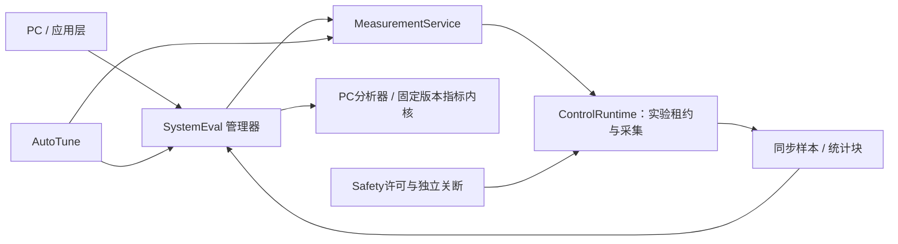

> 开发档案 · 历史规划 · 2026-10-26 统一归档
> 原文位置：`software/servo_v1/2026-10-22_文档汇总/2026-10-22_文档汇总/系统性能评估模块实施路径.md`。
> 以下保留当时的配置、试验过程、失败结果和结论；“当前/最新/已验证”均指记录当时。现行说明见[架构说明](../架构说明.md)。
> 原文命令和代码块内的路径保持历史写法；Markdown 链接已按新目录调整。原路径基准为工程根目录或原文另行指定的目录。
> 本文属于当时的设计或验收方案，不能据此认定其中所有功能已经实现或通过实板测试。

# 系统性能评估模块实施路径

基线：2026-10-22。本文沿用“只写Markdown、不修改固件”的范围。对象为当前电流/速度控制平台及规划中的20 Hz位置环、200:1减速器和双编码器系统。

## 1 模块定位

新增独立SystemEval模块，回答“这套系统在什么工况下达到什么性能、数据是否可信、相对基线是否改善”。AutoTune负责提出参数，SystemEval按冻结的验收规范评价结果，Safety负责保护，PcLink负责传输。整定算法不能自行修改评分规则或把失败试验从报告中删除。

SystemEval提供两种运行方式：被动观测，不改变当前控制参考；主动评估，通过统一实验服务申请有限激励。两种方式都不能直接操作PWM、关闭保护或修改正式控制参数。整定验证与独立验收使用同一个计算内核，但分开数据集、工况和结果ID。

“性能”同时包含控制响应、跟踪精度、抗扰与机械影响、测量质量、实时性、内存、通讯和可靠性。不能用一个加权总分掩盖故障、截止时间违例或位置反馈失效。

## 2 已有基础与能力边界

| 现有来源 | 可复用能力 | 不能直接声称的能力 |
|---|---|---|
| [current_loop_test.h](../../servo_v1/Tests/Inc/current_loop_test.h)及实现 | D/Q阶跃、正弦；512条记录；限幅后参考、反馈、电压、序号；饱和计数和最大误差 | 尚无完整上升/调节时间、可信频响、全系统评分 |
| [speed_commission.h](../../servo_v1/Servo/Inc/speed_commission.h)及实现 | 速度/电流实验、PRBS与连续运行遥测 | 当前调试流程不是通用位置性能评估 |
| [measurement_manager.h](../../servo_v1/Tests/Inc/measurement_manager.h) | 统一对象加union的组织方式 | 当前只定义NONE/MOS_DRIVER，不能当作已存在的SystemEval |
| [encoder.h](../../servo_v1/Modules/Encoder/Inc/encoder.h) | 编码器事务、错误、反馈年龄及部分FOC耗时 | 部分统计仅覆盖特定读角/调试路径，不是所有模式统一统计 |
| [tim1_pwm.h](../../servo_v1/Modules/Three_Phase_Driver/Inc/tim1_pwm.h) | 采样窗口、触发点、提交拒绝、实际采样间隔 | 预装载寄存器快照不等于示波器测得的PWM作用时刻 |
| [timing_probes.h](../../servo_v1/Core/Inc/timing_probes.h) | 编码器事务和FOC时序探针 | 异步SPI事务持续时间不是CPU独占时间 |
| [waveform_generator.h](../../servo_v1/Tests/Inc/waveform_generator.h) | 有界快照队列与抽样遥测 | 低速显示波形不能证明高频闭环响应 |

现有电流记录每条32 B，512条约16 KiB，与速度PRBS记录共享union；不要为SystemEval再分配同等大数组。速度PRBS实际采集间隔8 ms，即125 Hz，Nyquist为62.5 Hz；这份记录可用于有限频段分析，不能用于数百Hz电流/速度环的验收。

还需修正四个适配细节：当前settle_s只推迟激励，采集从开始就消耗容量；512点在50 μs且不平均时仅覆盖25.6 ms，不足一个20 Hz周期。PRBS位宽16/32/64 ms的保持环节第一频谱零点分别为62.5/31.25/15.625 Hz，不能默认20 Hz附近都有足够激励。kind=6的旧记录列名iq_command_a实际保存速度参考rad/s。现有saturation_count合并了参考/积分限制及包含过调制区域的saturated标志，分母是原始有效Observe周期，不能用平均后的sample_count计算削顶比例。

当前只有电机端编码器。`motor`、`inferred_load`和`measured_load`是三种不同结果来源；前两者不能作为减速器输出精度的独立证据。缺少真实母线、温度、输入功率或负载转矩测量时，对应指标返回不可用，不能用模型常量冒充测量。

## 3 模块结构与统一管理结构体

建议放在 `Servo/SystemEval/Inc`、`Servo/SystemEval/Src`。把可共用的激励与测量抽成MeasurementService，由它唯一拥有实验参考租约、快照采集和共享工作区。AutoTune和SystemEval都是调用方，避免各自实现一套正弦发生器、时间戳和故障退出逻辑。



当AutoTune已经持有实验租约时，SystemEval只作为该实验的观察/评价子会话，不再申请第二份激励；独立主动评估才申请独占租约。被动评估不能偷偷引入扰动。资源冲突明确返回BUSY。

每轴一个 `system_eval_manager_t`：

| 子结构 | 管理内容 | 写入与生命周期 |
|---|---|---|
| identity | 轴、API/算法版本、评估会话ID | 初始化及开始时生成 |
| config | 被测环路、坐标来源、测试类型、窗口、幅值、频段、资源额度 | 启动前冻结，运行期间只读 |
| acceptance | 目标、阈值、工况矩阵、指标启用位、规则hash | 独立版本；整定器不能修改 |
| session | 状态、阶段、operation_id、超时、取消原因、实验租约 | 管理器推进 |
| baseline | 基线profile/数据/工况ID及结果摘要 | 比较期间不可变 |
| acquisition | 同步样本序号、有效计数、丢样、限幅、时间戳 | 实时生产者写，按块发布 |
| statistics | 均值、方差、平方和、峰值、频响累积、计数 | 有界增量计算，后台汇总 |
| result | 指标值、单位、状态、可信区间、判定及不通过原因 | 完成后只读 |
| provenance | 固件/参数/标定/滤波/调度版本、负载、温度和测量来源 | 开始时固定，变化即结束当前评价 |
| diagnostics | 自身耗时、工作区占用、分块丢失与重试 | 不影响保护决策 |
| ports/workspace | 时钟、快照、实验服务、结果仓库端口及外部缓冲 | Init绑定，禁止ISR动态分配 |

统计计算拆成纯函数/小对象：时域指标、频域指标、运行时间指标、质量判定、报告判定。HAL、UART、文件格式和GUI均放在适配侧。

## 4 对外接口与状态机

| 拟定接口 | 上下文 | 合同 |
|---|---|---|
| SystemEval_Init | 启动/停机 | 绑定manager、ports、workspace及大小 |
| SystemEval_Configure | 后台、IDLE | 配置+验收版本；检查能力、单位和资源，不开输出 |
| SystemEval_RequestStart | 后台 | 被动/主动模式、基线ID、工况ID；生成evaluation_id |
| SystemEval_ObserveCycle | 指定控制ISR | 同周期固定大小样本；只做必要增量统计/入队 |
| SystemEval_ObserveTiming | IRQ/运行时指定测量点 | 明确计时类型和是否包含抢占，不重复累计 |
| SystemEval_Service | 后台分片 | 合并块、数据质量检查、结果冻结、通知 |
| SystemEval_SubmitAnalysis | 后台 | 接收PC分析结果及输入hash、算法版本；标注PC计算来源 |
| SystemEval_RequestAbort | 后台/故障转发 | 幂等取消，释放观察/激励资源；不阻塞Safety动作 |
| SystemEval_GetStatus / ReadResult | 后台 | 一致快照与按结果ID分块回读 |
| SystemEval_Compare | 后台/PC | 相同规则与可比工况才做A/B；否则返回不可比较 |

状态机：`IDLE → PRECHECK → BASELINE_READY → ACQUIRE → ANALYZE → REPORT_READY → COMPLETE`；任何阶段可进入ABORTING/ABORTED，硬件故障产生FAULTED。纯被动会话不需要BASELINE_READY或激励租约，但仍需数据质量检查。

每个状态有最长停留时间。采集结束不等于评价完成；收到PC结果不等于MCU已验证分析正确。未经设备复核的PC指标可以展示和归档，但不得因此绕过参数提交或Safety条件。

## 5 统一测量与误差定义

每个控制样本至少带：boot_id、cycle_sequence、设备采样时刻、profile ID、坐标来源、continuity_epoch、有效位、原始请求r_requested、约束后参考r_applied、反馈y、限幅/保护标志。高频原始样本可用紧凑编码，元数据按块共享，不能每个周期复制整个配置。

必须同时保留三种误差：

```text
e_track = r_requested − y        对原始目标的跟踪误差
e_reg   = r_applied − y          对控制器实际接受目标的调节误差
e_limit = r_requested − r_applied 轨迹/电流/速度限制引入的差异
e_track = e_limit + e_reg
```

电流测试当前记录的是FOC矢量限幅后的参考。仅从它算出的误差不能证明未限幅原始命令跟踪得好。位置系统还要分别记录“上层目标→轨迹输出”的路径，以免优化器通过严重放慢轨迹得到看似优秀的调节误差。

位置误差先在统一连续坐标中相减，再转换为局部浮点。电机侧角度和负载侧角度不能直接相减；推算负载位置需要齿比、方向和零位。线性行程/有限角关节不使用最短单圈误差绕过限位；多圈丢失后该窗口位置指标无效。

非等间隔采样采用时间权重，例如在固定的分段保持积分约定下：`RMS(e)=sqrt(Σe[k]²·Δt[k]/ΣΔt[k])`，`IAE=Σabs(e[k])·Δt[k]`。记录窗口端点与最后一个样本如何处理。长缺口不插值伪造通过，先按数据质量规则拒绝。

## 6 评估指标表与计算规则

### 6.1 控制响应与跟踪

| 指标 | 定义与单位 | 判定注意事项 |
|---|---|---|
| 均值偏差 | 稳态窗口mean(e)，A/rad/s/rad | 明确是e_track还是e_reg |
| RMS、峰值绝对误差 | 时间加权RMS、max(abs(e)) | 两种误差分别报告；峰值不能被平均隐藏 |
| IAE/ITAE | abs(e)及t·abs(e)的时间积分 | 窗口/轨迹相同才能比较 |
| 上升时间 | 方向归一化的10%→90%到达时间 | 以声明的阶跃目标增量定义，极小/零阶跃返回不适用 |
| 超调 | 沿阶跃方向超过目标的最大量/阶跃幅值 | 正负阶跃一致；不能用未到达的最后样本替代目标 |
| 调节时间 | 首次进入目标容差并满足后续保持要求的时间 | 容差为max(绝对容差,比例×阶跃幅值)；有限窗口未收敛应FAIL/未观测，不能填0 |
| 稳态误差 | 末端指定窗口的平均及RMS | 必须有足够稳定窗口；稳态不足则INVALID |
| 反转表现 | 反向过零峰值误差、恢复时间、死区 | 电机侧不能据此独立确认负载侧齿隙 |
| 控制活动度 | Iq RMS、相电流峰值、指令差分RMS | 更小误差不能靠超出相同电流/热边界换取 |
| 饱和比例/最长连续饱和 | 限幅样本或时间占比，s | 区分参考、电压、积分、速度/加速度限制 |
| 扰动恢复 | 已知扰动时刻后的峰值偏差与恢复时间 | 没有扰动量测时只报告试验响应，不声称已知抗扰传递函数 |

常用阶跃指标实现可交叉核对[stepinfo定义](https://www.mathworks.com/help/control/ref/dynamicsystem.stepinfo.html)，但本项目冻结自己的目标、容差和窗口约定，尤其不能把带噪声的最后样本默认为真实终值。

### 6.2 频域、20 Hz与机械影响

闭环频响保存复数T(jω)、幅值、相位和有效性。带宽按相对低频参考增益的首次向下−3 dB交越定义，同时报告所有共振峰/后续交越，不能挑选最高一个交越点。扫频未覆盖交越时，只能报告下界或上界，不外推成一个确定带宽。

20 Hz验收同时给出：幅值、相位、测试幅度、负载、母线、温度、限幅状态、误差RMS/峰值及反馈来源。正弦目标峰值幅度为A时，基波误差峰值为`A·abs(1−T)`，相应RMS为`A·abs(1−T)/√2`，说明即使幅频尚未下降3 dB，相位滞后也会造成明显误差；非线性谐波及噪声还应单独统计。

频响质量使用重复窗口、激励能量、相干性和重复性评估。单段相干性可能恒为1，不构成质量证据；这一点可核对[mscohere官方说明](https://www.mathworks.com/help/signal/ref/mscohere.html)。参考→输出T与对象输入→输出G必须分开，闭环中的噪声相关性不能用普通谱比忽略；具体注入和辨识方法沿用[整定路径第7节](2026-10-22_闭环整定模块实施方案_规划记录.md#7-频响实验必须先把测量做对)。

相位/增益裕度只能在已识别开环及反馈结构满足条件时计算；不能直接从位置闭环T的相位读“稳定裕度”。多交越、强耦合与两质量系统需完整稳定性检查。

负载编码器接入后增加两侧位置差、往返迟滞、跟随误差、机械共振与预载变化测试。没有输出编码器时这些负载侧指标统一返回UNSUPPORTED，而不是把θmotor/200标为实测。

### 6.3 采样、滤波与时间对齐

CurrentTest的average_count是箱式样本平均，时间戳为块末而非中心。均匀Ts下N点平均的群延迟为`(N−1)Ts/2`；幅值响应为`abs(sin(NπfTs)/(N·sin(πfTs)))`，零频取极限1。参考和反馈同法平均且同步时，其共同滤波可在频响比值中抵消；不能笼统给所有比值再加一份相移。与原始激励或外部时间对比时则必须修正时间/滤波口径。

动态ADC触发导致dt变化，现有按样本数平均不等于时间加权平均。新评估首先用真实时间戳的正弦拟合/同步解调；需要均匀采样谱分析时，明确重采样、抗混叠和边缘处理。禁止用普通PC接收时间代替设备采样时间。

必须区分ADC采样、编码器锁存/传输、控制计算完成、PWM提交和真正作用时刻。当前没有独立测量的时刻标为ESTIMATED；用示波器或捕获通道补校核，不让软件自报延迟成为唯一证据。

### 6.4 实时性、资源与通信

| 指标 | 测量与含义 | 验收要求 |
|---|---|---|
| ADC ISR墙钟时间 | 入口到出口，含高优先级抢占 | max与分布并列；测得最大值不是形式化WCET证明 |
| 控制子阶段耗时 | 反馈、算法、PWM提交的独立探针 | 标明嵌套关系，不把包含区间相加 |
| CPU忙碌占比 | 非重叠区间/空闲计时，含采集开销 | 编码器DMA线上等待不计为CPU独占 |
| 截止裕量 | PWM最晚合法提交时刻−实际提交时刻 | 报告最小值和违例数；不能只与名义50 μs比较 |
| 周期抖动 | 实际周期−计划周期的分布及极值 | 动态采样相位与真正调度抖动分开 |
| 反馈年龄 | 当前控制使用时刻−传感器有效时刻 | 分路径统计；当前速度模式不能借用未更新的快读年龄 |
| 栈/内存 | map、固定缓冲峰值、嵌套ISR栈水位 | RAM静态与栈预算分别说明，不能把栈预留重复相加 |
| UART指标 | CRC/溢出/队列、设备处理延迟、设备时间往返 | 区分排队接受、DMA完成和线上TC完成 |
| 数据完整性 | source_sequence、块号、整体CRC | 丢包重传与真实缺样分开 |

PA0编码器探针包含异步SPI传输等待；FOC探针/ADC ISR耗时可能已经包含编码器抢占，不能再加一次编码器耗时来计算CPU负载。现有g_current_test_timing与g_speed_profile只覆盖特定调试路径；新增统计必须显式覆盖NORMAL、速度和评估模式。

## 7 数据质量先于性能结论

每个指标除数值还带状态，与参数字典一致：VALID、UNSET、UNSUPPORTED、STALE、INVALID、INSUFFICIENT_DATA、NOT_CONVERGED；越界使用独立原因码OUT_OF_RANGE，不新增另一套线上状态枚举。是否通过另用NOT_EVALUATED/PASS/FAIL/INCONCLUSIVE。状态与数值分离，不能用0或NaN偷偷表达所有失败。

硬门槛：同步数据有效、位置连续、配置未变化、激励与采集时基可追溯、没有未解释的缺样、没有超出实验许可。小信号线性频响窗口出现饱和即无效；大信号轨迹测试可保留饱和数据，但必须计入原始指令误差与限制占比。

新适配器单列reference_limit、voltage_limit、integral_limit、trajectory_limit和OVM占用，不能直接复用旧saturated总标志来解释物理削顶。首版线性频响验收只在无OVM工况进行；过调制能力另开试验报告。PRBS同时记录实际序列hash和有效频谱，127项二进制序列并不自动满足最大长度序列性质。

总体规则：有任一有效必选指标失败则FAIL；无有效失败但必选项无数据/不支持则INCONCLUSIVE；仅在全部必选项有效且通过时PASS。异常中止记录ABORTED/FAULTED及已有证据，绝不返回PASS。可选指标不足不阻止结论，但必须显示缺项。绝对误差限值未冻结时，精度验收只能INCONCLUSIVE，可独立给A/B比较结论。

完整报告绑定规则hash和输入数据hash。PC分析器与MCU实现同一指标版本，计算差异超过预定浮点/积分容差时停止自动提交。原始记录、统计块、处理方法和剔除区间均可追溯。

## 8 建议验收工况与门槛

| 类别 | 测试内容 | 首版门槛建议 |
|---|---|---|
| 电流环 | D/Q正负小阶跃、多工作点扫频 | 频响有效、无持续振荡；超调候选≤10%；相位裕度目标≥50°、跨工况最低≥45°，增益裕度≥6 dB，前提是模型适用 |
| 速度环 | 正反向、低速、恒速、扰动、共振频段 | 满足已冻结速度误差/电流/振动界限；滤波时延与带宽同时报告 |
| 电机位置 | 受约束轨迹、小阶跃、正弦、多圈/过零 | 在规定幅值下目标带宽≥20 Hz；推算输出坐标单独标明 |
| 负载位置 | 双编码器、空载/试验负载、预载正反、温度变化 | 真实输出端20 Hz及误差门槛；没有输出传感器不能通过此项 |
| 实时性 | 最重控制+编码器+合法最大通信+评估同时运行 | 最坏已测执行/抢占占实际截止窗口≤70%、deadline违例0；另报告覆盖范围 |
| 资源 | 发布构建map与嵌套栈测量 | 静态RAM建议≤80%、栈余量≥25%；现状94.24%需先回收 |
| 数据质量 | 正常、缺样、坏帧、饱和、时钟回绕 | 无效输入不能得到PASS；置信/重复性可解释 |
| 通讯 | 最大合法遥测、断线、旧包/重包、重启 | 沿用PcLink延迟与租约指标，不引入控制周期违例 |
| A/B收益 | 相同轨迹/负载/温度区间，至少5组配对试验 | 可预设RMS改善≥20%、峰值退化≤5%；全部硬约束通过；门槛需事先冻结 |

这些是待冻结的项目建议，不是当前实测成绩。20 Hz、200:1要求下，输出1°正弦需要电机约4189 rpm峰值和55122 rad/s²峰值加速度；测试幅值必须依据真实惯量/扭矩/母线能力选定。

分开辨识轨迹、优化轨迹和最终验收轨迹。A/B采用交替顺序，记录每次结果和离散度；5次只是首轮重复性起点，不能仅凭样本数宣称具有统计显著性。若测量分辨率/漂移大于改进量，结论为不确定。

## 9 分阶段实现及验收节点

| 节点 | 实施任务 | 验收标准 |
|---|---|---|
| E0 指标与契约 | 冻结误差、坐标、窗口、有效性、阈值版本、输入快照 | 每个指标有公式/单位/数据源；未知硬件量不可伪装有效 |
| E1 模块骨架 | manager、状态机、端口、结果ID、与MeasurementService互斥 | 全状态取消/超时/重复请求可测；被动模式不改变控制参考 |
| E2 纯指标内核 | 阶跃、加权RMS/IAE、正弦拟合、统计与判定 | 已知解析信号/离散模型金样本通过；正负/零阶跃、未收敛、缺样、饱和全部覆盖 |
| E3 板上观测 | 所有运行路径统一时序与质量采集，有限开销 | GPIO/独立计时交叉验证；仪表开关A/B证明不侵蚀冻结deadline预算 |
| E4 电流/速度评估 | 复用现有实验、记录r_requested/r_applied/y、PC分析 | MCU/PC同数据指标一致；频响工具已知模型建议≤0.5 dB、≤3°误差 |
| E5 位置与机械 | 整数连续位置、回零、齿比、输出传感器与工况矩阵 | motor/inferred/measured分离；失连续拒绝；对应坐标的20 Hz数据可重复 |
| E6 系统压力评估 | 通讯、CPU、内存、故障注入、时基回绕联测 | 至少2 h规定最大合法负载；无错误PASS、无评估导致的deadline违例；故障动作达标 |
| E7 自动验收集成 | AutoTune候选调用、规则锁定、A/B、结果回读与报告归档 | 候选不能改规则；数据或依赖hash不符拒绝；失败保留基线且可重现 |

软件测试和台架测试分层执行。文档阶段不需运行功率试验；真正实施时未满足Safety前置条件不得进入主动激励节点。

## 10 内存、计算预算与维护

SystemEval常驻管理和低阶统计建议≤1 KiB；复杂频谱、拟合和长历史放PC，共享原有规划8 KiB实验工作区，不再新增同等数组。该预算追加后必须重做全系统map，不能认为此前AutoTune/PcLink预算已自动包含评估模块。

ISR每周期只做明确需要的固定次数累积，分布直方图采用固定桶；百分位若由粗桶估计，报告分辨率及近似属性。方差采用稳定在线算法，长时间平方和做分块归一化/溢出检查，不能用两个巨大接近数直接相减导致负方差。

主动采集与普通遥测区分：评估需要的数据缺失必须使结果降级，不能像显示遥测一样静默丢弃后照常给PASS。模块自身异常只结束评估，控制与Safety继续独立运行；真正检测到保护事件仍由Safety执行动作。

## 11 上位机参数和结果接口

完整字段见[上位机读写参数表](2026-10-22_上位机参数字典草案_规划记录.md)，评估域为0xA000—0xAFFF，通用诊断域为0xB000—0xBFFF。它们是逻辑ID，不是内存地址。

配置项包含测试类型、环路、坐标、窗口/保持时间、误差容差、目标带宽、质量阈值和基线ID；运行项只读，包括会话状态、采样数、缺样/饱和、结果状态与结论。详细频响、指标集和原始记录通过有长度/版本/CRC的分块对象读取，不能用任意内存读取暴露内部数组。

GUI应先显示结论范围与有效性，再显示曲线和数字：例如“电机侧位置20 Hz已通过，负载侧未测试”。未收敛显示未收敛，不显示0 ms；带宽只测到15 Hz显示“尚不能证明20 Hz”，不自动延长曲线。
