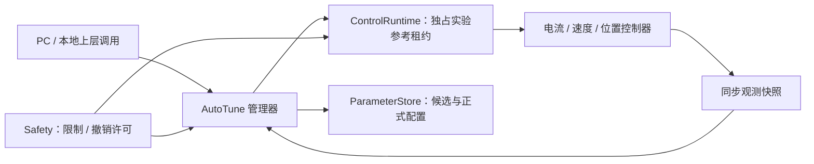

> 开发档案 · 历史规划 · 2026-10-26 统一归档
> 原文位置：`software/servo_v1/2026-10-22_文档汇总/2026-10-22_文档汇总/闭环整定模块实施路径.md`。
> 以下保留当时的配置、试验过程、失败结果和结论；“当前/最新/已验证”均指记录当时。现行说明见[架构说明](../架构说明.md)。
> 原文命令和代码块内的路径保持历史写法；Markdown 链接已按新目录调整。原路径基准为工程根目录或原文另行指定的目录。
> 本文属于当时的设计或验收方案，不能据此认定其中所有功能已经实现或通过实板测试。

# 闭环整定模块实施路径

基线：2026-10-22 当前源码；本文是待实施设计，不表示相关模块已经存在。目标是 200:1 减速器系统的 20 Hz 位置闭环，先使用电机端编码器，再加入输出轴编码器。本文只描述职责、数据、算法、开发步骤和验收，不修改固件。

## 1 结论与实施边界

采用“独立 AutoTune 管理器 + MCU 有界实验执行 + PC 辨识与候选设计”的结构。先用物理模型和实测频响获得可解释的稳定控制器，再选择性加入受约束的贝叶斯优化。所有候选必须通过独立验证，才能提交为正式参数。

整定顺序为：基础保护与时序 → 标定 → 初始电流闭环 → D/Q 电流频响与整定 → 速度估计和机械辨识 → 速度环 → 电机侧位置环 → 输出侧双编码器位置环。外环整定期间冻结已验收内环；修改内环、反馈滤波或调度周期后，相关外环验证自动失效。

20 Hz 暂按小信号闭环位置幅频响应相对低频增益下降 3 dB 的带宽目标定义。它不是“20 Hz 正弦运动没有误差”。用户尚未给出绝对跟踪误差限值，因此当前可承诺的是建立可复现的误差比较与优化路径，不能预先宣布最终精度达标。

## 2 现有代码如何复用

| 现有入口                                               | 保留能力                                   | 实施时的调整                                                |
| ------------------------------------------------------ | ------------------------------------------ | ----------------------------------------------------------- |
| [foc_current_tuning.c](../../servo_v1/FOC/Src/foc_current_tuning.c) | R/L/Vbus/延迟模型生成电流 PI               | 作为初值设计器；模型预测带宽与实测带宽分开存储              |
| [foc_interface.c](../../servo_v1/FOC/Src/foc_interface.c)           | 算法与硬件端口分离                         | 增加统一观测快照与受限激励接口，不依赖 AutoTune             |
| [current_loop_test.c](../../servo_v1/Tests/Src/current_loop_test.c) | 电流阶跃、正弦、记录和指标                 | 抽取纯激励/统计能力；大缓冲由实验内存池提供                 |
| [speed_commission.c](../../servo_v1/Servo/Src/speed_commission.c)   | 电角标定参数、速度 PI 调试、PRBS、限时实验 | 迁移实验配置和参考产生；保护移至 Safety，输出使能归生命周期 |
| [encoder.c](../../servo_v1/Modules/Encoder/Src/encoder.c)           | 电角度、机械角、多圈数、速度快照           | 先补连续性、恢复状态、可配置控制用速度估计与时刻语义        |
| [main.c](../../servo_v1/Core/Src/main.c)                            | 回调装配、当前模式切换                     | 保留装配；不继续增加整定状态机与全局实验字段                |

当前不存在完整位置控制器、负载编码器接口、统一参数事务和 PC 双向协议。它们属于本路线明确列出的开发节点，不能把现有电流 PI 设计函数包装成“全闭环自动整定”后即宣告完成。

## 3 模块结构、依赖与统一管理结构体

建议目录为 `Servo/AutoTune/Inc` 与 `Servo/AutoTune/Src`，主机测试放 `Tests/Host`。文件职责建议如下；名称可按工程风格调整，职责应保持。

| 单元                         | 唯一职责                                               |
| ---------------------------- | ------------------------------------------------------ |
| autotune_manager             | 生命周期、实验编排、结果状态、失败回退                 |
| autotune_excitation          | 正弦/阶跃/PRBS 等有界激励和包络                        |
| autotune_measurement_adapter | 接入共用MeasurementService，获取时间对齐样本与单频统计 |
| autotune_design              | MCU 可承担的确定性模型初值设计                         |
| autotune_validation_adapter  | 调用SystemEval固定规则与基线比较，消费通过/拒绝结果    |
| autotune_port                | 控制运行时、保护、参数仓库、时钟的适配契约             |
| PC analysis                  | 频响处理、模型拟合、鲁棒设计、可选优化器、报告         |



统一入口为每轴一个 `autotune_manager_t`。统一结构体意味着一个明确的生命周期和所有权，不意味着外部可以随意改写其成员。

| 子结构          | 必需内容                                                   | 写入规则                            |
| --------------- | ---------------------------------------------------------- | ----------------------------------- |
| identity        | axis_id、API版本、固件/算法版本                            | 初始化后固定                        |
| config          | 环路、频率范围、激励幅值、采样策略、时间/位移/能量上限     | 后台校验后作为不可变快照发布        |
| session         | experiment_id、请求号、state、phase、deadline、owner_token | 后台编排；实时状态通过邮箱返回      |
| baseline        | 正式 profile ID/hash、被测工况、基线指标                   | 开始时固定，不能被候选覆盖          |
| candidate       | 候选 profile、来源模型/优化器、父版本、有效性              | 校验后暂存；不能直接修改正式 PI     |
| realtime        | 激励相位、周期数、幅值包络、当前注入点                     | 仅控制 ISR 写；后台通过命令邮箱交互 |
| measurement     | 复数累积、均值/方差、饱和/丢样/异常计数                    | 实时采集；分块发布只读结果          |
| quality         | SNR、相干性、重复性、拟合区间、拒绝原因                    | 后台/PC计算，MCU复核边界            |
| result          | 各环实测频响、误差、结论、验证依赖                         | 完成后只读，带实验序号              |
| ports/workspace | 回调表、context、外部分配工作区及长度                      | Init 时绑定，不动态申请内存         |

外围 `axis_context` 聚合 Control、Safety、AutoTune、PcLink 的上下文。AutoTune 不包含 UART、HAL 或具体定时器寄存器；控制器也不包含 AutoTune 头文件。通过轻量通用类型共享反馈和参数，避免头文件循环依赖。

追加的[系统性能评估方案](2026-10-22_系统性能评估实施方案_规划记录.md)将验收规则与计算内核收敛到SystemEval，激励和采集收敛到MeasurementService。AutoTune内部保留实验编排与必要会话统计，不重复分配长期原始记录；已有租约下的评价作为观察子会话接入，不再申请第二份激励。候选不能修改验收门槛。所有PC配置/状态/结果编号见[参数表](2026-10-22_上位机参数字典草案_规划记录.md)。

## 4 清晰可调用的接口契约

以下是接口设计名称，不是已存在的函数。

| 接口                            | 调用上下文     | 输入/输出与约束                                    |
| ------------------------------- | -------------- | -------------------------------------------------- |
| AutoTune_Init                   | 启动、输出关闭 | manager、ports、workspace；验证内存大小和版本      |
| AutoTune_Configure              | 后台、IDLE     | 实验配置；返回 OK/范围错误/不支持/依赖未满足       |
| AutoTune_RequestStart           | 后台           | 请求ID、环路、基线profile；只排队，不立即开输出    |
| AutoTune_Service                | 后台、有界分片 | 推进准备、分析、候选管理、结果发布；每次有执行预算 |
| AutoTune_BeginCycle             | 固定控制ISR    | 接收周期号/状态，返回本周期有界激励描述            |
| AutoTune_EndCycle               | 同一控制ISR    | 接收该周期实际执行与测量快照，累积数据；不发送串口 |
| AutoTune_RequestAbort           | 后台/故障转发  | 幂等地撤销实验；Safety 的立即关断不等待它          |
| AutoTune_GetStatus / ReadResult | 后台           | 一致快照，带版本和实验ID；不得读取半写结构体       |
| AutoTune_SubmitCandidate        | 后台           | PC/内部设计器提供候选及基线hash；MCU再次验证范围   |
| AutoTune_RequestCommit          | 后台、停机     | 仅允许已通过验证且依赖版本未变化的候选             |

控制端口只提供 `claim_experiment/release_experiment`、`read_capabilities`、`request_safe_stop`、`stage_test_profile`、`read_profile`、`commit_profile` 等能力。实验租约限定轴、环路、注入点、幅度、有效期和允许状态；每周期由 ControlRuntime 再限幅。AutoTune 不直接访问 MOE，不直接改其他模块全局变量。

注入点必须区分：参考值叠加、控制器输出叠加、外环暂时固定。一次只能激励一个已声明通道。执行记录同时包含“请求激励”和“限幅后实际激励”；受限数据不得用于线性模型验收。

统一观测样本至少包含：周期序号、ADC时刻、角度有效时刻、PWM实际作用时刻、Id/Iq参考及实测、Ud/Uq请求及可实现值、Vbus来源/值、机械角/速度、输出角来源、限幅标志、保护状态、连续性epoch、当前profile ID。使用 SI 单位，电压 pu 的归一化基准必须随数据提供。

## 5 状态机和事务

```text
IDLE → PRECHECK → CLAIM → BASELINE → EXCITE → ANALYZE
     → CANDIDATE_READY → VALIDATE → ACCEPTED → COMMIT → COMPLETE
任意活动状态 → ABORTING → ABORTED
设备故障 → FAULTED（由 Safety 先完成动作）
```

每个状态必须有进入条件、最长时间、退出原因和清理动作。`ACCEPTED` 只表示候选通过本次实验，不等于已经正式生效。PC ACK、实验结束、候选通过、提交成功是四个不同事件。

首版采用停机换参：撤销实验激励 → 正常减速/卸载至允许停机状态 → 关闭输出 → 保存必要状态 → 装载候选并重置积分 → 小幅受限启动 → 验证。带负载不能随意卸载时，应先完成机械保持策略，不能把“清零 Iq”写成通用安全停止。中途故障直接执行 Safety 策略，候选不自动恢复输出。

候选参数通过独立临时 profile 测试，正式 profile 始终保留。失败后先停机，再恢复基线；禁止在振荡中直接热切回旧 PI。持久化采用版本、CRC、双槽或等效掉电原子机制，Flash擦写仅在允许的停机窗口。恢复旧参数不代表恢复旧运行命令。

## 6 算法选择与近期研究的实际用法

| 层级     | 方案                                       | 本项目采用方式与边界                                     |
| -------- | ------------------------------------------ | -------------------------------------------------------- |
| 必做     | RL模型初值 + 闭环频响辨识 + 频域PI设计     | 可解释、占用小；覆盖首个可验收版本                       |
| 必做     | 顺序整定与实际验证                         | 电流、速度、位置逐层验证；不把计算出的增益当实测结论     |
| 条件采用 | 多正弦、PRBS、频响数据驱动设计             | 单频结果可信后缩短实验；先控制峰值因数、非线性和频率泄漏 |
| 条件采用 | 速度观测器、机械模态陷波、有限带宽扰动观测 | 每个附加环节必须以噪声/时延/鲁棒性收益证明价值           |
| 研究扩展 | 安全约束贝叶斯优化、数字孪生辅助选点       | PC离线计算，MCU只执行经过复核的有限实验                  |

成熟实现可参考 TI [SFRA 用户指南，2019 修订](https://www.ti.com/lit/ug/spruik4a/spruik4a.pdf) 的注入/采集分离思路；它面向 C2000，不能把二进制库或性能数字直接移植到 STM32。MathWorks 当前 [FOC Autotuner 文档](https://www.mathworks.com/help/mcb/ref/fieldorientedcontrolautotuner.html) 展示了已有稳定控制器上的逐环扰动辨识与候选验证流程；可借鉴方法，不要求项目依赖其商业工具，也不表示它直接解决本项目位置环。

截至 2026-10-22 核对的近期研究：

- [SafeCtrlBO，2026-05-14 v3](https://arxiv.org/abs/2408.16307v3)：利用加性高斯过程描述控制参数之间的低阶耦合，并在 PMSM 速度平台验证减少硬件试验的效果。其安全结论依赖概率模型与明确条件；不能替代硬件保护，也不能直接证明 200:1 负载位置环的效果。
- [Guided Bayesian Optimization，IEEE TASE 2025](https://research.tudelft.nl/en/publications/guided-bayesian-optimization-data-efficient-controller-tuning-wit/)：用闭环数据维护数字孪生，指导部分候选探索，报告减少真实设备试验。适合后续 PC 优化器，前提是模型误差能在独立数据上量化。

落地选择：首版不将学习算法放入 20 kHz ISR；在确定性方案通过后，以 2—4 个有物理意义的参数做小范围优化，例如速度 Kp/Ki、位置 Kp、速度前馈系数。固定保护限制、反馈估计器、已验收电流环；优化器不得把提高电流上限或放宽故障阈值当作改善性能的方法。

每次优化记录候选、预测收益、不确定度、约束裕量、实测结果和拒绝原因。若新方法不能在相同试验次数、相同负载和相同保护条件下优于确定性基线，就保留基线，不为“使用前沿算法”而增加长期维护负担。

### 6.1 PC优化器的具体实现顺序

1. **定义可比较的输入。** 正增益使用相对基线的对数参数，前馈/陷波使用明确物理参数；一次选择2—4维。每个候选绑定电流环、速度估计器、采样率、负载工况版本；版本改变后不得混用旧训练数据。
2. **定义收益与硬约束。** 例如`J=w1·RMS(e)/e_scale+w2·max(|e|)/e_peak_scale+w3·t_settle/t_scale+w4·RMS(ΔIq)/iq_scale`。分母由测试规格冻结并设置非零下限；权重在开始前固定。电流、行程、温升、振荡和裕度分别建约束，不将它们折算成可抵消的奖励项。
3. **建立初始可信区域。** 已验证基线是必需起点，附近参数范围先由实测频响、离散模型和限幅能力筛选。靠近基线不等于自动安全；没有证据的点不得直接上机。
4. **先实现普通低维GP基线。** 对重复实验估计噪声，用目标GP和各约束GP分别建模，保留拟合诊断。之后才比较加性核结构，如速度PI参数组、位置增益/前馈参数组及有证据的交互项；维度很低时无需强行使用复杂核。
5. **选择候选。** 在模型与硬边界允许的区域内，以期望改善等采集准则提出候选，并用约束上置信界过滤：约束写成`g_i≤0`时要求`μ_i+β·σ_i≤0`。β及置信WO解释必须写入实验配置；模型假设不满足时，这不是物理安全证明，MCU的独立保护仍然有效。
6. **MCU再次验证与执行。** 提交候选只获得待验证状态；MCU检查参数范围、依赖版本、实验额度和实时能力，按停机换参流程执行。异常中止作为约束失败/删失数据保留，不能把失败样本删去以美化模型。
7. **先验证后扩大范围。** 新点通过独立短验证才加入可信区域；不直接复现论文边界扩张算法，除非其假设已在本模型与工况下审查。没有可行候选时终止并保留基线。
8. **最后加入数字孪生辅助选点。** 用真实闭环数据拟合并持续检查预测误差；模拟结果标注为模拟，不能充当真实约束通过记录。只允许它减少无价值的真实试验，最终收益仍按A8的独立硬件A/B数据判定。

优化器与设备交换的是版本化候选/实验结果，接口可被任何上层脚本调用。优化器崩溃、拟合失败或置信区间异常时，设备结束当前有限实验，不等待PC解算才能维持本地控制。

## 7 频响实验：必须先把测量做对

### 7.1 激励、同步与统计

首版使用逐频正弦，从小幅度开始。每个频点先等待暂态衰减，再采集完整整数周期；低频点的实验时间按周期数决定，不能统一固定为很短的窗口。采样以控制周期号和真实时间戳对齐，不使用 PC 接收时间作为采样时间。

MCU 用递推振荡器/查表生成激励，用同步正交解调累计输入、输出的复数幅值和能量；对递推数值漂移有定期归一化与测试。一次仅保存少量频点及统计量，完整长记录保存在 PC 或按块回读。使用块内单精度累积、周期归一化或补偿求和，验证长实验舍入误差；不盲目在 M4F ISR 中使用软件双精度。

数据质量门槛建议：至少 4 段可比较的稳态周期块，设计频带相干性不低于 0.9，重复实验幅值差不超过 1 dB、相位差不超过 5°；这些是候选项目门槛，需通过噪声实验冻结。一个傅里叶窗口算出的形式相干性可能恒为 1，不能拿它证明数据可信。缺样、饱和、保护限幅和位置不连续应使对应频点无效。

频率上限必须低于相关环路 Nyquist 频率；首轮设计区间建议不超过执行频率的 1/10，并把采样/保持/延迟计入模型。机械共振搜索覆盖必要频段，不能只测目标交越点附近几个点就声称排除了高频不稳定。

### 7.2 区分闭环响应与被控对象

参考注入得到的是参考到输出的闭环响应 T，不能直接命名为电机模型 G。若满足已知单位负反馈、无额外前馈等条件，可用 `L=T/(1−T)` 推导开环；在 T 接近 1 的频段该计算病态，不能作为主要辨识依据。

推荐在明确的控制输出求和点注入独立扰动 d，同时记录实际对象输入 u 和输出 y。用 `G≈Syd/Sud` 估计对象频响；这里 `Syd=E[Y·conj(D)]`，`Sud=E[U·conj(D)]`，要求扰动与测量噪声独立、系统局部线性、输入通道与时延定义清楚。不能在闭环里直接把带噪声的 `Y/U` 当成无偏对象模型。

电流对象输入应为实际可实现的 D/Q 电压，并记录 Vbus、死区和调制限制；若只能使用电压指令，模型必须明确包含逆变器与执行延迟的不确定性。速度对象可选 Iq参考→速度，其模型包含电流闭环；若改用实测 Iq，必须重新定义识别结构。位置对象通常为速度指令→位置，包含已闭合速度环。每份结果必须保存注入点图与输入输出单位。

### 7.3 从频响得到可用控制参数

首版PC设计器按固定步骤执行：验证频点质量 → 分离辨识/验证数据 → 拟合低阶对象与延迟，或直接使用频响表 → 用与固件一致的离散PI实现计算开环 → 扫描候选交越频率与PI零点 → 排除裕度、噪声增益、执行器限幅和参数边界不满足的候选 → 选取性能与裕度均衡的候选 → 用未参与拟合的数据及目标板重新验证。

电流对象先尝试R/L加延迟；速度对象先尝试含电流闭环的惯量/阻尼模型，出现可重复机械峰谷再增加两质量模态，避免高阶模型吸收噪声。模型残差在目标设计频带有明显结构时应拒绝简单模型，不能只依靠一个全局拟合百分比。

评估时使用固件实际积分离散化、采样保持、反馈滤波和总时延。频率响应中有多个交越点或不稳定极点时，不能只报告一组相位/增益裕度；需要完整稳定性分析。当前控制结构没有充分测量支持时，应降低带宽或停止发布候选。

## 8 分步骤实施与节点验收

节点表中的数值是建议冻结的工程门槛；硬件额定值、允许位移、负载边界等未知项必须先填入试验配置，不能用示例数字代替。未满足前置条件的节点可以完成软件模拟验收，但不能进入带功率实验。

### A0：建立安全、时序、内存与数据基线

做法：完成审查报告 R01—R04 的保护补齐，统一输出使能，建立 ADC/控制提交独立存活监督；复用一个实验工作区，先释放当前 94.24% RAM 占用；给测量、控制提交、配置都加序号和版本。

交付：控制链路时序图、硬件限值表、实验可用RAM、baseline profile、无功率故障注入记录。

验收：所有输出模式能被相同的故障动作撤销；ADC停顿、CPU异常、超限和参数非法均有可测动作；最坏控制执行及抢占占用不超过实际截止窗口的70%；静态RAM建议≤80%，栈实测留≥25%余量。阈值冻结后所有实验均引用同一版本。

### A1：完成标定、数据可信度和初始稳定控制器

做法：验证电流零偏范围/噪声/量程，电流极性，编码器方向/极对数/电角偏置；明确电压、Id/Iq和力矩常数的峰值/RMS约定。接入真实母线测量，或使用可追溯的台架测量并记录限制。先以已有确认稳定的小电流参数建立初始闭环。

R/L未知时先做低能量独立辨识：电阻考虑逆变器压降，电感考虑采样时延和不同电流工作点；转子位置与运动条件必须被实际约束和记录。固定电角度不等于转子被机械锁定，不能默认忽略反电动势。R/L估计用于启动初值，不取代后续闭环验证。

验收：零输入与多个已知电流点的比例/极性检查通过；标定失败不开放输出；电角变化与机械变化关系正确；数据失效能结束实验；初始闭环在规定小信号范围内无持续振荡、无饱和、无保护触发。标定重复性限值由台架能力制定并记录。

### A2：先验收整定框架与测量工具

做法：建立 manager、状态机、端口和注入/观测接口；用已知一阶/二阶/纯延迟对象在主机仿真中复现频响，再用板上软件回环验证时间戳。实现取消、超时、资源互斥、数据缺口拒绝和基线保留。

验收：已知模型设计频段误差建议≤0.5 dB、≤3°；插入一个丢样或饱和窗口后该频点不得通过；任何状态取消都释放租约；重复Start不重复运行；CPU/RAM在预算内；用同一数据在PC和MCU算出的统计量在浮点容差内一致。

### A3：D/Q 电流环辨识与整定

做法：先D后Q，另一路保持已验证状态；记录轴间耦合。由 `Kp=L·ωc/Vdc`、`Ki=R·ωc/Vdc` 获得模型初值，再利用测得频响及数字延迟选择可实现带宽。不同Ld/Lq必须独立设计；电压pu、积分的dt和母线基准与现有FOC严格一致。

使用电流小阶跃与扫频验证候选，在正负方向及多个工作电流验证。首版保持线性调制。当前设计探索可从500—1000 Hz电流带宽区间评估，但该区间不是强制值，若实测延迟/电感/噪声不支持，应给出可实现范围。

验收：D/Q实测带宽、相位和幅值曲线齐全；设计目标相位裕度建议≥50°，跨工况最低允许值≥45°、增益裕度≥6 dB，并检查多交越与耦合风险；无持续振荡，无测量/执行饱和；阶跃超调建议≤10%，积分恢复有界。仅有SISO频响不能证明强耦合系统稳定，耦合显著时需扩大模型或缩小工作域。

### A4：速度估计与机械对象辨识

做法：把当前10 ms显示式平滑与控制速度估计分离，比较可配置差分滤波、αβ/PLL观测器。固定PWM分频节拍，记录估计时延。以小Iq扰动辨识刚体惯量/摩擦和共振；惯量换算必须注明电机侧/负载侧，理想折算为 `Jload/N²`，齿隙与弹性不能用此折算消除。

单电机编码器阶段只能辨识电机端可观测动态，不能声称完整辨识了负载扭转。正反方向、不同预载和低速过零分别采集。若齿隙导致明显非线性，分工况建模并保守限制外环。

验收：同一数据集比较噪声RMS与相位延迟，证明新估计器在速度环设计频段有收益；辨识与验证数据分离；共振峰可重复；连续性失效不会被滤波掩盖；不能可靠辨识时输出“数据不足/工况不适用”，不生成高带宽候选。

### A5：速度环整定

做法：固定电流环，以实测包含内环的频响设计速度PI；必要时加入针对已识别模态的窄带陷波。先低带宽再递进，验证负载惯量变化和正反转。100—200 Hz只作为支持20 Hz位置目标的探索区间，不是按固定倍数强行设置的指标。

验收：规定工况下的频响、裕度、速度阶跃、恒速噪声和扰动恢复全部记录；无Iq/电压持续饱和，温升满足已核实边界；陷波启用后对频率漂移仍保留裕度；修改速度估计器或内环profile后本节点需重验。

### A6：电机端位置环与200:1坐标

做法：补位置控制器、整数多圈误差、回零和轨迹模块。先用位置P产生电机速度参考，必要时加入有限积分/速度前馈，避免一开始堆叠两个强积分器。外部输出坐标为rad；若位置误差在输出侧坐标，反馈与前馈换算到电机速度只乘一次N=200。轨迹分别限制位置、速度、加速度、加加速度，不能沿用连续速度调试的300 rpm/s限制作为所有工况的固定值。

验收：已知方向/转数的单位转换、过零、长时间累计、重启回零、丢帧失效全部通过；电机侧/推算负载侧分别命名。使用满足速度/加速度/电流能力的小信号幅值测频响，目标−3 dB带宽≥20 Hz；同时报告20 Hz幅值、相位和跟踪误差。没有输出轴测量时，只能验收电机端及推算坐标的控制性能。

例如输出轴1°、20 Hz正弦需要电机峰值约4189 rpm及55122 rad/s²；这是运动学要求，不代表电机能提供所需扭矩。必须用已测惯量、扭矩和母线裕量选幅值，防止饱和实验冒充线性带宽测试。

### A7：输出轴编码器与双环整定

做法：输出轴编码器提供真实负载位置，电机编码器继续提供换相与内环速度。统一时戳、方向、零位、齿比和回零契约，建立两编码器差值的弹性/间隙观测。先降低外环带宽辨识两质量模态，再逐步提升；不直接平均两轴角度。

验收：相同运动在两编码器坐标中一致且差异可解释；传感器任一失效时执行声明的停机/降级策略，不能无提示切换反馈源；空载/额定试验负载/正反预载下验证负载端20 Hz目标及鲁棒性。此时才可对真实输出角的误差给出结论。结构参考[双环实践说明](https://support.maxongroup.com/hc/en-us/articles/360012314820-EPOS4-Dual-loop-control)，具体参数仍由本机频响决定。

### A8：受约束优化与真实收益证明

做法：锁定安全基线，在PC对少量参数做受约束优化。先用模型和边界检查淘汰候选，再逐个进行有限硬件试验。每轮有最大试验次数、时间、能量和连续失败上限；达到上限即保留最佳已验证参数并结束。

目标函数建议为归一化跟踪RMS、峰值误差、恢复时间、控制活动度的加权和；各量用冻结基准归一化。电流、位移、温升、振荡、稳定裕度和实时截止是硬约束，不能用其他指标的好成绩抵消。优化轨迹与最终验证轨迹不同，防止只对一种正弦过拟合。

验收：至少5组配对A/B验证，记录温度/负载/母线并交替测试顺序；报告每次结果、均值/离散度和最坏值。候选门槛可预设为主指标RMS至少改善20%、峰值误差退化不超过5%、所有硬约束通过；这些百分比是待项目确认的收益门槛，不是承诺。若基线已满足目标且改善不显著，应判“保持基线”，不能制造虚假收益。

### A9：发布、回归与维护

做法：把通过的profile、工况范围、依赖hash、实验报告一起发布；保留上一版可启动配置。新增电机/减速器/编码器、调度变化、估计器变化和采样比例变化触发对应验证失效。

验收：停机提交、断电中断提交、回滚、版本不兼容、重复命令、PC断线均通过；恢复上电不自动启动；正常运行无需PC维持每个控制周期；同一验收集可复测，报告能追溯到固件和原始数据。

## 9 资源预算与“有效”的判定

建议AutoTune常驻管理+单频统计≤2 KiB，实验缓存与其他调试功能共享8 KiB；仅在回收现有大缓冲后落实。配置采用外部提供工作区与显式长度，编译期固定上限。高频路径禁止动态分配、UART等待、Flash写入、矩阵拟合和无界迭代。

每个频点结果包含：频率、实际幅值、复数响应、置信范围/重复性、有效周期数、丢样/饱和计数、profile及配置版本。每次整定最终报告必须回答：调了哪一环、在哪个工况、改了哪些参数、实测改善多少、哪些工况退化、何时不能使用、怎样恢复基线。

“真实有效”需要板上频响和负载运动数据。本次文档没有进行电机实验，因此不能给出现成的最终增益或声称20 Hz已经实现。建议按A0—A7交付首版可验收能力，A8作为有收益才纳入产品的增强项。

## 10 与其他模块的联调顺序

先落地[故障保护](2026-10-22_故障保护模块实施方案_规划记录.md)的快速关断/独立监督与[PC通讯](2026-10-22_串口PC通讯实施方案_规划记录.md)的状态读取、命令事务，再实现A2测量骨架。首个端到端样例只完成“一次受限电流频响实验 → 回读结果 → PC生成候选 → MCU拒绝/验证 → 停机提交”。这个闭环通过之后，才扩展到速度、位置和优化器。
