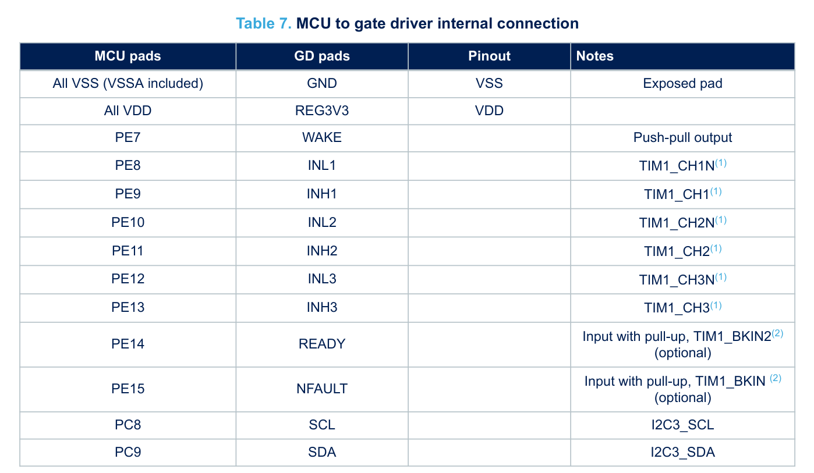

1, 根据图片和stspin32431芯片的数据手册，配置mcu引脚和外设。包括i2c, 和ready,nfault,wake.修改要符合hal工程规范，包括文件组织方式，和代码风格。

2, 新增TIM1三相互补PWM配置（tim1_pwm.c/h），以及按模块管理的MOS管驱动测量波形。

   | 文件 | 职责 |
   | --- | --- |
   | `Core/Src/tim1_pwm.c` | TIM1 初始化：中央对齐 20 kHz，CH1..CH3 互补输出 + 500 ns 死区，CH4 作为 ADC 采样触发；duty -> compare 映射 |
   | `Core/Inc/tim1_pwm.h` | 定时参数（载波、死区、duty 标度）与 PWM 控制接口 |
   | `Core/Src/tim1_pwm_verify.c` | MOS管驱动测试：选中一相 10% 高侧 PWM，其余两相 0% 高侧占空比，带看门狗 |
   | `Core/Inc/tim1_pwm_verify.h` | MOS管驱动测试接口与运行说明 |
   | `Core/Inc/measurement_manager.h` | 统一测量管理结构；当前模块为 `MEASUREMENT_MODULE_MOS_DRIVER`，可修改 U/V/W 测量相 |

   复用文件：`Core/Src/stm32g4xx_hal_msp.c`（TIM1 时钟 / NVIC / PE8..PE13 复用）、
   `Core/Src/stm32g4xx_it.c`（TIM1_CC、TIM1_UP_TIM16 向量）、`Core/Src/main.c`（调用顺序）。

3,

   当前测试配置位于 `Core/Src/main.c` 的 `g_measurement_manager`：

   - `config.mos_driver.phase`：`MOS_DRIVER_PHASE_U/V/W`
   - `config.mos_driver.duty`：Tim1Pwm 的 0..1000 标度，100 表示 10%
   - 选中相使用该占空比，其余两相为 0%，低侧导通并将相端拉到 PGND
   - `config.mos_driver.moe_enable`：MOE 控制，1 保持输出，0 关闭输出
   - `config.mos_driver.duration_ms`：预留字段，保持 0 表示连续输出
   - 运行中修改 `phase` 或 `duty` 后，主循环会同步更新 TIM1 比较寄存器
   - 需要停止输出时调用 `Tim1PwmVerify_Stop(&g_measurement_manager)`，或将 `moe_enable` 改为 0 后运行一次测量任务
