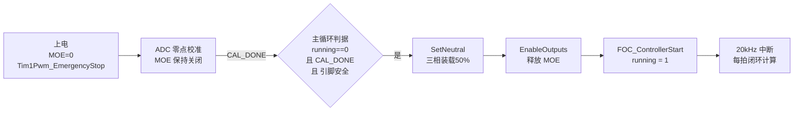
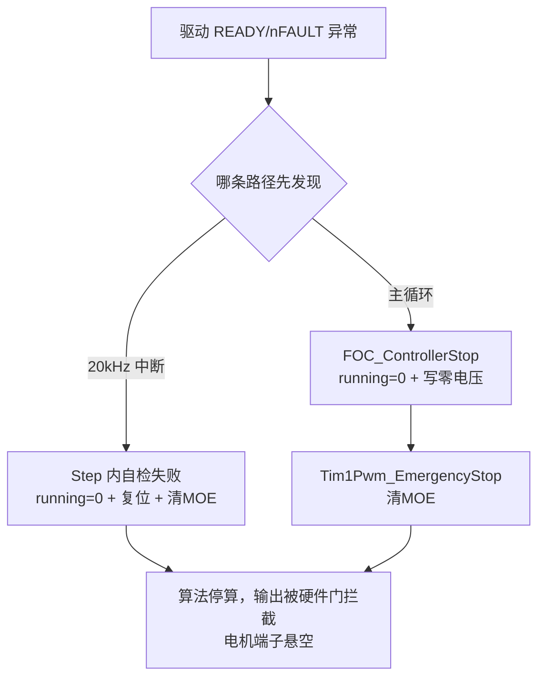

# g_foc_controller.running 与 MOE 是如何配合工作的

> 适用工程：`servo_v1`（STM32G4 + STSPIN32G4）
> 相关源码：`Core/Src/main.c`、`FOC/Src/foc_interface.c`、`Modules/Three_Phase_Driver/Src/tim1_pwm.c`、`Modules/Driver_Communication/Src/drv_monitor.c`

---

## 1. 一句话结论

这套系统用**两级开关**控制电机：

- **`running` 是软件开关（智能门的"允许计算"标志）**：只决定 20 kHz 的 FOC 电流环要不要算。它本身**不能**让电流流过电机。
- **MOE 是硬件开关（TIM1 高级定时器的主输出使能位）**：只决定已算好的六路 PWM 波形**能不能送达栅极、加到电机上**。它本身**不会**产生任何算法输出。

**两个开关都打开，电机才转；任何一个关掉，输出就是安全的。** 源码注释里对此写得很明白（`main.c` 第 296 行）：

> MOE 是 TIM1 高级定时器的最终输出门。FOC running 只代表算法允许运行，两者必须分开管理。

---

## 2. 两个开关分别是什么

### 2.1 running —— 算法层的"意图"标志

| 项目   | 说明                                                                                                                     |
| ------ | ------------------------------------------------------------------------------------------------------------------------ |
| 是什么 | `foc_controller_t` 结构体里的一个 `uint8_t` 成员，全局实例为 `main.c:72` 的 `g_foc_controller`                   |
| 谁置 1 | `FOC_ControllerStart()`（`foc_interface.c:44`）——**只写标志，不碰任何硬件**                                  |
| 谁清 0 | `FOC_ControllerStop()`，或 `FOC_ControllerStep()` 每步自检发现不安全时自行清零                                       |
| 作用点 | `FOC_ControllerStep()` 入口（`foc_interface.c:88`）：`running == 0` 直接 return，读电流、算 PI、写占空比全部不执行 |

关键点：**running 被清零后，PWM 比较寄存器会"冻结"在最后一次写入的占空比上**。如果没人去关 MOE，功率级会继续输出这个最后的波形——所以算法层自己不敢保证安全，必须靠 MOE 兜底。

### 2.2 MOE —— 硬件层的"最终输出门"

| 项目   | 说明                                                                                                                                      |
| ------ | ----------------------------------------------------------------------------------------------------------------------------------------- |
| 是什么 | TIM1 的 `BDTR` 寄存器中的 Main Output Enable 位，是 STM32 高级定时器特有的安全机制                                                      |
| 谁置 1 | `Tim1Pwm_EnableOutputs()`（`tim1_pwm.c:412`，即 `__HAL_TIM_MOE_ENABLE`）                                                            |
| 谁清 0 | `Tim1Pwm_EmergencyStop()`（`tim1_pwm.c:423`，即 `__HAL_TIM_MOE_DISABLE_UNCONDITIONALLY`），由硬件在**当拍**执行，不等软件轮询 |
| 作用点 | MOE=0 时六路栅极驱动信号（含互补输出）被拉到无效电平，电机端子电气悬空，**无论 CCR 里写着什么占空比都输出不了**                     |

两个细节值得注意：

1. **必须用"无条件"版本清 MOE**。普通 `__HAL_TIM_MOE_DISABLE()` 只在所有 CCxE/CCxNE 都已清零时才生效，对运行中的功率级会悄无声息地什么都不做（`tim1_pwm.c:419` 注释）。
2. **MOE=0 期间六个引脚不被 MCU 驱动**（工程里 `OSSI/OSSR` 故意关闭，见 `tim1_pwm.c:243`），交给栅极驱动芯片自己的上下拉，因为那个电平对驱动芯片意味着什么无法从数据手册确定。

### 2.3 一个生活化的类比

把整套系统想象成家里的燃气热水器：

- **`running` = 温控器有没有在工作**（要不要算加热指令）；
- **MOE = 燃气阀门开不开**（热量能不能真的输出）；
- 温控器坏了乱发指令，阀门关着就不会出事；
- 阀门意外漏气，温控器就算停止工作，热水器的燃烧状态也取决于阀门本身。

安全设计的原则就是：**两道独立的关卡，任何一道都能单独终止输出。**

---

## 3. 启动流程：先放"中点"，再开门，最后才允许计算

`main.c` 主循环第 298~305 行的启动判据是**三个条件同时成立**：

```c
if ((g_foc_controller.running == 0U) &&                                  // ① 当前是停止态
    (CurrentSampling_GetCalibrationState() == CURRENT_SAMPLING_CAL_DONE) && // ② 电流零点校准完成
    (MainFoc_IsPowerStageSafe(NULL) != 0U))                               // ③ 驱动 READY=1 且 nFAULT=1
{
    Tim1Pwm_SetNeutral();        // 第一步：三相先装载 50% 中性占空比
    Tim1Pwm_EnableOutputs();     // 第二步：开 MOE
    FOC_ControllerStart(&g_foc_controller);  // 第三步：置 running = 1
}
```

这三行每一步的顺序都有用意：

1. **`Tim1Pwm_SetNeutral()` 先写 50% 占空比。** MOE 一旦打开，输出的就是 CCR 里当前的值。如果不预先加载中立值，开闸瞬间可能把某个随机的旧占空比直接加到电机上，造成 torque spike（电流冲击）。而且 50% 占空比恰好让低侧开关每拍有足够导通时间刷新自举电容（`tim1_pwm.c:18~21` 注释）。
2. **再 `Tim1Pwm_EnableOutputs()` 开 MOE。** 此刻 running 还是 0，PWM 频率在跑、但输出的只是中性 50%——电机三相端子上没有差分电压，不会转。
3. **最后 `FOC_ControllerStart()` 置 running。** 下一个 20 kHz 中断到来时，`FOC_ControllerStep()` 才开始真正闭环：读电流 → 算 PI → 写占空比。输出从无压差的"预充电"状态平滑进入受控状态。

**为什么校准必须是前提？** `main.c:258` 注释说明：上电后 `Tim1Pwm_EmergencyStop()` 保持硬件关断，ADC 在 MOE=0 的"安静"状态下采集零点偏置（`current_sampling.c` 的 CAL_SETTLING → COLLECTING → DONE 状态机）。如果先开 MOE，运放输入的开关噪声会污染偏置采集，校准值就是错的——错误偏置会被算法当成电流，第一个闭环拍就输出错误电压。

启动流程的时序：



---

## 4. 停止流程：两条路径，都是"先停脑子，再关阀门"

### 4.1 主循环路径（慢一拍，兜底用）

`main.c` 第 306~313 行：running 为 1 但驱动不再安全时——

```c
FOC_ControllerStop(&g_foc_controller);   // 清 running + 复位积分器 + 写零电压 + 调 disable_output
Tim1Pwm_EmergencyStop();                  // 无条件清 MOE（双保险）
```

`FOC_ControllerStop()`（`foc_interface.c:57`）内部做的事依次是：清 `running` → 复位 PI 积分器 → 通过 `write_voltage` 回调下发零电压 → 通过 `disable_output` 回调关断输出。而 `main.c:114` 里这个回调绑定的正是 `Tim1Pwm_EmergencyStop()`——所以 MOE 实际被清了两次，第二次是显式冗余，防止端口回调缺失时漏关。

### 4.2 20 kHz 中断路径（快，不等轮询）

`FOC_ControllerStep()`（`foc_interface.c:86`）**每一拍执行前**都先调 `is_power_stage_safe` 回调（绑到 `DrvMonitor_IsPowerStageSafeFast()` → `STSPIN32G4_PinsAllowSwitching()`，只读 GPIO 的 READY/nFAULT 两个引脚，不走 I2C，执行时间恒定，所以在中断里用是安全的，见 `foc_interface.c:81~84`）。一旦发现不安全，**当场在微秒级完成**：

1. 自己清 `running = 0`（不再等主循环来停）；
2. 复位积分器；
3. 调 `disable_output` → 清 MOE。

这条路径保证故障响应最多延迟一个载波周期（50 µs），而不是主循环的任意轮询间隔。

停止的因果链：



---

## 5. 为什么要"分开管理"？

如果只有一个标志，会出现两种危险：

| 假设的设计                           | 问题                                                                                            |
| ------------------------------------ | ----------------------------------------------------------------------------------------------- |
| 只有 running，软件直接写占空比就完事 | 算法失能或标志被意外保持 1 时，输出没有硬件层面的否决权；而且 CCR 冻结在旧值，电机持续带电      |
| 只有 MOE，算法照常每拍计算           | running 无处表达"算法是否获准闭环"，中断里会拿未校准的垃圾电流继续算，PI 积分器带着错误状态狂舞 |

分开之后形成**串联的双重关断**：

- `running=0` 保证**不会再产生新的错误占空比**（软件层拦截"算错的指令"）；
- `MOE=0` 保证**即使 CCR 里有旧的/错误的占空比也送不出去**（硬件层拦截"不该输出的波形"）；
- 启动顺序刻意安排为「先中立 → 开门 → 后开算」，任意时刻都不存在"门开着、脑子没跟上、占空比是随机值"的窗口。

另外 `main.c:309` 注释还点出恢复策略：**故障消失后不会自动重新上电**。清故障（I2C CLEAR 寄存器）后驱动重新报 READY，但重启的三道门槛（校准完成 + 引脚安全 + 主循环显式判断）保证重新放行 MOE 是一次有依据的决定，而不是电平抖动引发的自动重连。

---

## 6. 速查表

| 想做的事                   | 用哪个接口                                                          | 位置                   |
| -------------------------- | ------------------------------------------------------------------- | ---------------------- |
| 让算法开始闭环计算         | `FOC_ControllerStart()`（仅置 running=1，不开硬件）               | `foc_interface.c:44` |
| 让六路 PWM 真的到达电机    | `Tim1Pwm_EnableOutputs()`（置 MOE）                               | `tim1_pwm.c:412`     |
| 立即切断功率输出（硬件级） | `Tim1Pwm_EmergencyStop()`（无条件清 MOE）                         | `tim1_pwm.c:423`     |
| 让算法停算并复位状态       | `FOC_ControllerStop()`                                            | `foc_interface.c:57` |
| 查询输出门当前是否打开     | `Tim1Pwm_IsOutputEnabled()`                                       | `tim1_pwm.c:431`     |
| 中断里的实时安全自检       | `is_power_stage_safe` 回调 → `STSPIN32G4_PinsAllowSwitching()` | `foc_interface.c:99` |

**记忆口诀：running 管"算不算"，MOE 管"出不出去"；先中立、再开门、后开算；出问题先停算、必关阀。**

---

## 7. 当前源码审查结论（以实际调用顺序为准）

当前上电路径是：

```text
MX_GPIO_Init
  -> MX_TIM1_Init：启动 TIM1/CH4，但 MOE 保持 0
  -> Tim1Pwm_EmergencyStop：再次无条件清 MOE
  -> DrvMonitor_Init：清理驱动锁存状态并确认 READY
  -> 启动 OPAMP、配置 ADC、CurrentSampling_Start
  -> 等待 20 ms
  -> CurrentSampling_RequestCalibration：进入 SETTLING
  -> （宏为 0 时不打开 MOE）
```

因此当前驱动模块不报 `VDS_P` 的直接原因是：

1. `CURRENT_SAMPLING_ENABLE_LOW_SIDE_CALIBRATION` 当前固定为 `0U`；
2. 校准阶段不调用 `Tim1Pwm_EnableCalibrationLowSide()`；
3. 正常 FOC 的 `Tim1Pwm_EnableOutputs()` 目前也未放行；
4. 即使 CCR 里有比较值，MOE=0 时也不会送到功率级栅极输入。

这解释了“驱动没有报错”，但不等于 ADC 已经工作。ADC 的采样链和驱动功率链是两条独立链路，
应分别用 `sample_sequence/JEOS/JDR` 与 `READY/nFAULT/STATUS` 验证。

### 7.1 复位电流尖峰

若固件曾经使用宏值 `1U`，旧实现会在上电校准阶段先写 `CCR=0` 再打开 MOE。此顺序会在
驱动器刚解除关断时立刻改变三相输入，导致复位后的瞬态电流尖峰。现在接口改为“中性 CCR →
MOE → 等待 10 ms → CCR=0”。在未完成硬件验证前必须保持宏为 `0U`。
