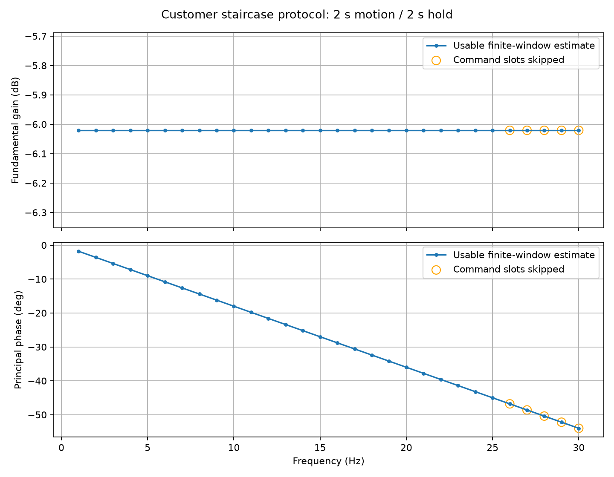

# 客户位置指令测试结果

每频点 2 秒运动 + 2 秒原点保持；1–30 Hz；0→2→0° 的 40 点阶梯三角指令。
幅值为基波峰值，相位为输出相对实际已下发指令的主值相位，负号表示滞后。
包含启动暂态，未执行稳态相干性判定；此表不能直接作为闭环带宽验收。
flags：1 拟合无效，2 速度限幅，4 斜坡限幅，8 指令漏点，16 中止，32 时间覆盖不足。
estimate_usable 仅表示幅相数值及限幅/时间检查通过；protocol_complete 还要求没有指令漏点。

| Hz | 参考基波 ° | 输出基波 ° | 增益 dB | 相位 ° | 样本 | flags | 漏点 | 估计可用 | 指令完整 |
|---:|---:|---:|---:|---:|---:|---:|---:|:---:|:---:|
| 1 | 0.8106 | 0.4053 | -6.0206 | -1.8000 | 2000 | 0 | 0 | True | True |
| 2 | 0.8106 | 0.4053 | -6.0206 | -3.6000 | 2000 | 0 | 0 | True | True |
| 3 | 0.8106 | 0.4053 | -6.0206 | -5.4000 | 2000 | 0 | 0 | True | True |
| 4 | 0.8106 | 0.4053 | -6.0206 | -7.2000 | 2000 | 0 | 0 | True | True |
| 5 | 0.8106 | 0.4053 | -6.0206 | -9.0000 | 2000 | 0 | 0 | True | True |
| 6 | 0.8106 | 0.4053 | -6.0206 | -10.8000 | 2000 | 0 | 0 | True | True |
| 7 | 0.8106 | 0.4053 | -6.0206 | -12.6000 | 2000 | 0 | 0 | True | True |
| 8 | 0.8106 | 0.4053 | -6.0206 | -14.4000 | 2000 | 0 | 0 | True | True |
| 9 | 0.8106 | 0.4053 | -6.0206 | -16.2000 | 2000 | 0 | 0 | True | True |
| 10 | 0.8106 | 0.4053 | -6.0206 | -18.0000 | 2000 | 0 | 0 | True | True |
| 11 | 0.8106 | 0.4053 | -6.0206 | -19.8000 | 2000 | 0 | 0 | True | True |
| 12 | 0.8106 | 0.4053 | -6.0206 | -21.6000 | 2000 | 0 | 0 | True | True |
| 13 | 0.8106 | 0.4053 | -6.0206 | -23.4000 | 2000 | 0 | 0 | True | True |
| 14 | 0.8106 | 0.4053 | -6.0206 | -25.2000 | 2000 | 0 | 0 | True | True |
| 15 | 0.8106 | 0.4053 | -6.0206 | -27.0000 | 2000 | 0 | 0 | True | True |
| 16 | 0.8106 | 0.4053 | -6.0206 | -28.8000 | 2000 | 0 | 0 | True | True |
| 17 | 0.8106 | 0.4053 | -6.0206 | -30.6000 | 2000 | 0 | 0 | True | True |
| 18 | 0.8106 | 0.4053 | -6.0206 | -32.4000 | 2000 | 0 | 0 | True | True |
| 19 | 0.8106 | 0.4053 | -6.0206 | -34.2000 | 2000 | 0 | 0 | True | True |
| 20 | 0.8106 | 0.4053 | -6.0206 | -36.0000 | 2000 | 0 | 0 | True | True |
| 21 | 0.8106 | 0.4053 | -6.0206 | -37.8000 | 2000 | 0 | 0 | True | True |
| 22 | 0.8106 | 0.4053 | -6.0206 | -39.6000 | 2000 | 0 | 0 | True | True |
| 23 | 0.8106 | 0.4053 | -6.0206 | -41.4000 | 2000 | 0 | 0 | True | True |
| 24 | 0.8106 | 0.4053 | -6.0206 | -43.2000 | 2000 | 0 | 0 | True | True |
| 25 | 0.8106 | 0.4053 | -6.0206 | -45.0000 | 2000 | 0 | 0 | True | True |
| 26 | 0.8106 | 0.4053 | -6.0206 | -46.8000 | 2000 | 8 | 80 | True | False |
| 27 | 0.8106 | 0.4053 | -6.0206 | -48.6000 | 2000 | 8 | 160 | True | False |
| 28 | 0.8106 | 0.4053 | -6.0206 | -50.4000 | 2000 | 8 | 240 | True | False |
| 29 | 0.8106 | 0.4053 | -6.0206 | -52.2000 | 2000 | 8 | 320 | True | False |
| 30 | 0.8106 | 0.4053 | -6.0206 | -54.0000 | 2000 | 8 | 400 | True | False |

