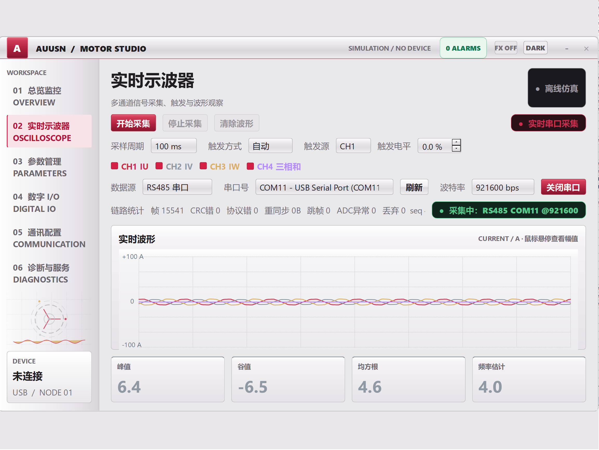

# 功能 Issue 与实现状态

用于伺服调试的上位机，当前只适用于 Windows 11。

状态说明：`[x]` 已实现并验证，`[ ]` 待实现。后续功能请继续追加到对应章节。

先实现一下目标

## 功能实现

- [X] 示波器功能：按 V2 `pc_waveform_protocol.md` 解析 1～4 通道可变长度帧，按模式和通道 ID 动态显示名称、数量、数值与工程单位；鼠标移动到示波器中时显示当前位置各可见通道的精确值。
- [X] 生成示波器功能实现文档：见 `oscilloscope_implementation.md`。

## 界面布局

- [X] 初始窗口保持 16:10，面积约为此前半屏窗口的 2 倍（接近可用屏幕）；窗口固定尺寸，移除最大化与拖拽缩放入口。
- [X] 默认使用亮色主题，并保留手动切换深色主题的能力。

## Debug

	

- [X] 修复当前界面上下大量空白：窗口与内部设计画布统一为 16:10；链路统计改用紧凑文本，完整详情保留在鼠标提示中，不再被状态标签遮挡。
- [X] 修复打开串口后开始/停止按钮无效：停止时仍持续读取并统计串口数据，但暂停向示波器写入；重新开始后恢复实时绘图，清除波形始终可用。
- [X] 实时波形新增鼠标滚轮纵轴缩放，范围为 ±0.1 A 至 ±1000 A，坐标轴实时显示当前量程。

debug:

1,在设备连接前，开始采集按钮不可以生效

2，波形

## 后续功能

- [ ] 在此追加新需求。

## V2 协议升级

- [x] 支持协议版本 2，以及 `12 + 5*N` 的 17/22/27/32 字节变长帧。
- [x] 支持电压开环、电流开环和自定义模式，按帧内 1～14 通道 ID 动态绑定曲线。
- [x] 支持 A、pu、rad、V 与无单位占空比的显示和悬停读数。
- [x] 模式或通道 ID 列表变化时清除旧曲线并重新绑定，兼容切换期间残留旧帧。
- [x] 自动化测试覆盖变长粘包/拆包、CRC、非法字段、模式切换、混合单位与序号连续性。

## 本次验证

- [X] V2 变长协议解析、CRC、分块/粘包、错帧重同步、模式/通道映射、序号回卷、ADC 连续性和三相演示源均有自动化测试。
- [X] 完整单元测试通过。
