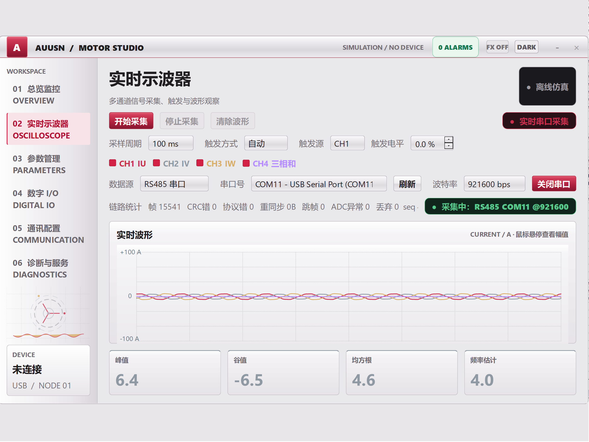

# 功能 Issue 与实现状态

用于伺服调试的上位机，当前只适用于 Windows 11。

状态说明：`[x]` 已实现并验证，`[ ]` 待实现。后续功能请继续追加到对应章节。

先实现一下目标

## 功能实现

- [X] 示波器功能：按 V2 `pc_waveform_protocol.md` 解析 1～4 通道可变长度帧，按模式和通道 ID 动态显示名称、数量、数值与工程单位；鼠标移动到示波器中时显示当前位置各可见通道的精确值。
- [X] 生成示波器功能实现文档：见 `oscilloscope_implementation.md`。

## 界面布局

- [X] 初始窗口保持 16:10，面积约为此前半屏窗口的 2 倍（接近可用屏幕）；窗口固定尺寸，移除最大化与拖拽缩放入口。
- [X] 默认使用亮色主题，并保留手动切换深色主题的能力。

## Debug

	

- [X] 修复当前界面上下大量空白：窗口与内部设计画布统一为 16:10；链路统计改用紧凑文本，完整详情保留在鼠标提示中，不再被状态标签遮挡。
- [X] 修复打开串口后开始/停止按钮无效：停止时仍持续读取并统计串口数据，但暂停向示波器写入；重新开始后恢复实时绘图，清除波形始终可用。
- [X] 实时波形新增鼠标滚轮纵轴缩放，范围为 ±0.1 A 至 ±1000 A，坐标轴实时显示当前量程。

debug:

1,在设备连接前，开始采集按钮不可以生效

2，波形

## 后续功能

- [ ] 在此追加新需求。

## V2 协议升级

- [x] 支持协议版本 2，以及 `12 + 5*N` 的 17/22/27/32 字节变长帧。
- [x] 支持电压开环、电流开环和自定义模式，按帧内 1～14 通道 ID 动态绑定曲线。
- [x] 支持 A、pu、rad、V 与无单位占空比的显示和悬停读数。
- [x] 模式或通道 ID 列表变化时清除旧曲线并重新绑定，兼容切换期间残留旧帧。
- [x] 自动化测试覆盖变长粘包/拆包、CRC、非法字段、模式切换、混合单位与序号连续性。

## 示波器交互增强

- [x] 所有工程改动记录到 `change_log.md`，并通过根目录 `AGENTS.md` 约束后续 GPT 持续追加日志。
- [x] 实时波形增加真实毫秒横轴，最新采样点为 0 ms，历史数据使用负时间显示。
- [x] 双击波形打开独立放大窗口；独立窗口共享实时数据，但保留自己的缩放和平移状态。
- [x] 普通滚轮缩放幅值；按住空格并滚动鼠标滚轮缩放时序范围。
- [x] 按住鼠标左键左右拖动，浏览当前缓存中的历史波形。
- [x] 峰值、谷值、均方根和频率统计增加通道选择，不再固定统计第一通道。

## 波形界面边界修复

- [x] 修复主界面横轴刻度被下方统计区域遮挡的问题，增加底部安全间距并分行显示刻度和单位。
- [x] 修复独立窗口末端刻度、单位和悬停数值框可能超出边框的问题。
- [x] 快捷键提示改为独立窗口右上角“操作帮助”按钮，点击后在波形上方逐行展开，不覆盖波形。
- [x] 独立波形窗口使用轻量静态样式，不增加动画或高开销视觉特效；标题栏方案曾改为无边框模式，后续根据反馈恢复原生标题栏。

## 波形弹窗与数据源调整

- [x] 操作帮助和关闭按钮悬浮于波形右上角，不占用或压缩绘图区空间。
- [x] 独立窗口曾移除系统标题栏并新增“关闭 ×”按钮；该历史方案已在后续界面修正中恢复为原生标题栏。
- [x] 独立窗口目标尺寸调整为此前的两倍；屏幕不足时自动限制为可用桌面的 96%。
- [x] 数据源移除“仿真模型”，只保留 RS485 和显式选择的内置正弦演示；未连接数据源时不生成波形。
- [x] 统计通道选择移至波形上方，避免被底部统计卡片区域遮挡。

## 波形标题与弹窗稳定性修正

- [x] “实时波形”和英文副标题移到波形方框外，方框内部只保留绘图区。
- [x] 独立波形弹窗恢复系统标题栏，并提供标准最小化、最大化和关闭按钮。
- [x] 增加弹窗连续关闭和重新打开测试，验证刷新定时器能够安全停止及恢复，未复现闪退。

## 波形卡片和弹窗帮助修正

- [x] 波形卡片曾使用一致的 12 px 内边距；根据后续反馈改为 1 px 贴框融合方案。
- [x] 弹窗操作帮助默认展开并保持在波形子控件顶层，鼠标悬停数值不能覆盖帮助面板。
- [x] 操作帮助在亮色和深色主题下均使用白色背景与深色文字。
- [x] 取消波形内部“关闭 ×”按钮，仅保留系统标题栏关闭按钮。

## 示波器闪退与背景框融合

- [x] 示波器定时采样增加异常隔离，数据源或帧处理异常时安全停止采集，不再让异常离开 Qt 回调。
- [x] 异常时关闭当前数据源、显示错误状态并写入 `logs/servo_crash.log`；重新选择数据源可以恢复采集。
- [x] 应用启动时启用 Python 未捕获异常及原生故障日志。
- [x] 波形图使用 1 px 卡片内沿和圆角背景裁剪，与背景框融合且保留完整边线。
- [x] Windows 原生窗口后端完成 5 次弹窗关闭/重开及持续采集冒烟测试，未出现退出。

## 本次验证

- [x] 主图及弹窗悬停后无需点击即可空格＋滚轮缩放时间轴，离开或失焦时清除空格状态；Windows 原生 Qt 事件测试通过。
- 用户确认：暂不调整传输速率，保持 921600 波特率、默认 1 kHz 波形输出。

- [x] 空格＋滚轮以鼠标所在时间点缩放，主图和弹窗一致，缓存边界限制窗口。
- [x] “采样周期”更名为“接收周期”，连接时保留用户选择；10 ms 不代表每 10 ms 一个采样点。

- [x] 波形与外框强制最小尺寸约束，保留完整正负轴及横轴；标题与统计选择共用一行。
- [x] 统计通道文字自适应，阴影及颜色随选中通道切换，包括独立弹窗。
- [x] 密集波形保峰谷绘制优化，统计文本降频；Windows 四通道 2500 点绘制中位耗时实测 17.63 ms。
- [x] 帮助快捷键、解释分别逐行左对齐，白色本地样式与独立列间距。
- [ ] 截图中的百万安培数值需原始串口帧及板端数据核验；目前协议解码与文档一致。

- [X] V2 变长协议解析、CRC、分块/粘包、错帧重同步、模式/通道映射、序号回卷、ADC 连续性和三相演示源均有自动化测试。
- [X] 完整单元测试通过。
- [X] 独立窗口、时序缩放/平移边界、共享实时数据、统计通道选择、标题层级及连续关闭/重开均已通过离屏 UI 测试。
