## 第 1 页

| MT6835 21位高分辨率、高精度磁性角度编码器IC 特性和优势 ￭ 基于先进的AMR各向异性磁阻技术，0~360°绝 对角度位置检测 ￭ 21位核心角度分辨率，支持最高120,000转/分 钟的转速 ￭ 角度输出延时2微秒~10微秒 ￭ 提供客户端的自动非线性校准模式，无数据交互、 自动计算补偿，实现<±0.07°的INL ￭ -40~125℃ 温度范围内均可工作 概述 ￭ 可同时支持增量ABZ、增量UVW、 PWM绝对值 和4线SPI总线输出 MT6835是麦歌恩微电子推出的新一代基于 ￭ 增量ABZ输出支持1~16,384脉冲/圈，任意整数 先进的各向异性磁阻（AMR）技术的高速高精 分辨率客户可编程 度角度编码器芯片。该芯片内部集成了互成45° 摆放的两对AMR惠斯通电桥组成的敏感元件以 ￭ 增量UVW输出支持1对极~16对极任意整数对极 及高性能的专用信号处理电路。由于AMR器件 客户可编程 在用作角度测量应用的时候工作于饱和区（饱和 ￭ 内置3.3V~5.0V 均可编程的EEPROM 磁场为300高斯），实际工作时，芯片只对平行 于芯片表面的磁场的方向变化做出响应，而与磁 场强度无关。因此MT6835在使用过程中，对于 磁铁本身的加工误差以及磁铁和芯片的安装距离 误差要求相对较低。 MT6835提供替代传统光电编码器的增量 ABZ输出接口，增量输出最大分辨率为4096脉 冲/圈或者是16384步/圈；同时MT6835也提供 了增量UVW输出，分辨率支持1~16对极/圈。 应用 MT6835提供了4线SPI接口，供上位机或者 MCU来读取芯片内部的21位绝对角度数值。同 ￭ 绝对角度位置传感器 时单线输出的PWM也可提供分辨率为12位的绝 对角度数据。 ￭ 直流无刷电机控制 MT6835的核心性能提升在于提供了客户端 ￭ 伺服电机控制 方便的自校准模式，通过自校准模式可以补偿由 ￭ 闭环步进电机控制 于磁铁的不理想、结构安装的偏差所带来的各种 ￭ 替换部分光电编码器的应用 非线性，从而大大提升INL特性。 |
| --- |
| www.magntek.com.cn \| 磁技术带来美妙变革 1 1.3版 2022年12月 |

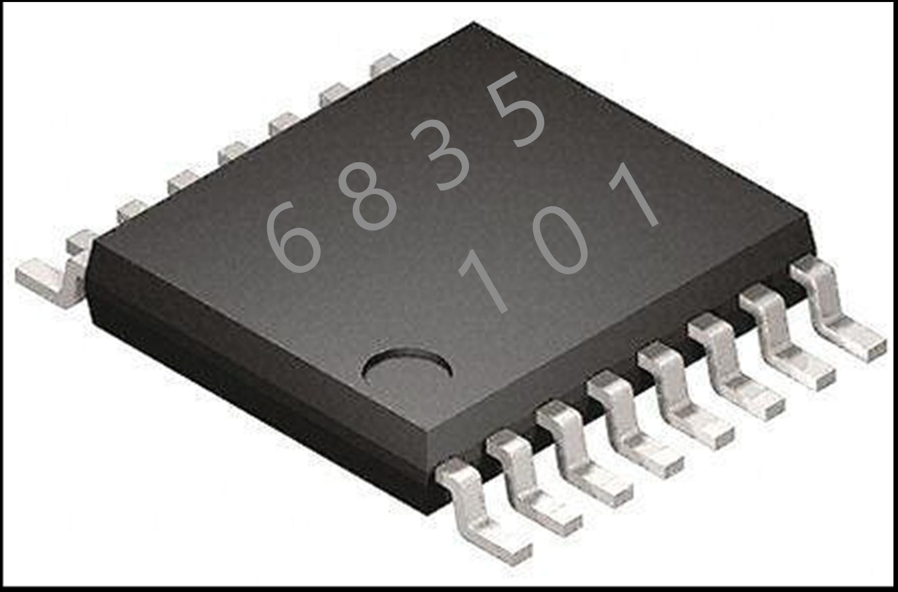

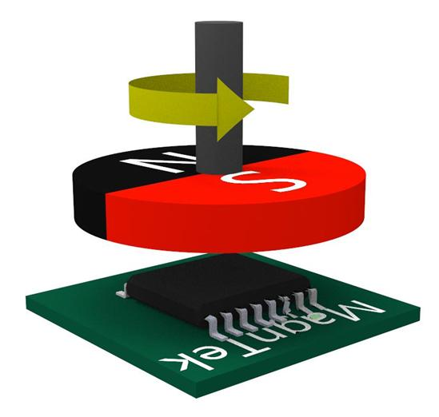

## 第 2 页

| MT6835 21位高分辨率、高精度磁性角度编码器IC 目录 特性和优势………….……………..……………...…………………………..…………………………….…….………1 应用……………………………….……….……………………………………………..…………………………….…….1 概述……..………………..…………………………………….………………………………….…………………………1 1 引脚定义………………………..………………….…..………………………………………..…..…………….3 2 芯片功能框图…………….…….………………..………………………………………………………………4 3 极限参数………………………..……..…………………….…………….……………………………………..5 4 正常工作条件……………………..……….………………………………………………………………………..5 5 电气性能参数……………………………………….……………….……………………………………...……..6 6 外加磁场参数..…………………………………………………….……………………………………...……..9 7 输出模式………..………………………………………………………………………..…………..……………10 7.1 I/O引脚功能配置………………..………..…………………...….………….………………….…………..10 7.2 参考电路…………………..……………………………………………..…………….……………………..….11 7.3 正交A、B和零位Z信号输出(ABZ 模式)……..………………..………………..……………..12 7.4 UVW输出模式…………….……..……….……………..……….……………...……………………..……..17 7.5 脉宽调制(PWM)输出模式.……………………………………….….....………………….………….…18 7.6 SPI接口……………..….…………………………..………………………………………………..…….19 7.6.1 SPI参考电路…..……………….……………….……..…….…………………………………….19 7.6.2 SPI时序……………….…….…………………………..…….…………………………………….20 7.6.3 SPI协议.……...………..………….…………………………...………………………………….…21 7.6.4 SPI单字节读寄存器…..……..………………..………..….…………………………………….22 7.6.5 SPI单字节写寄存器….…..………………………….….....………………………………….…22 7.6.6 SPI烧录EEPROM…………………………………………...………………………………….…23 7.6.7 SPI自动设置零点寄存器…………....………............………………………………….…24 7.6.8 SPI单字节读角度数据………..………………...........………………………………….…25 7.6.9 SPI连续读角度数据………………..…………….........………………………………….…26 8 设置零点寄存器并烧录进EEPROM………………………………….…….…..…………………….27 9 校准…..………………..……..………….…………………….……………………………………………………….28 9.1 出厂基础校准……………………………………..……………….……...……………………….…………28 9.2 客户端自校准……….……………………..……………………………………………………………..….29 9.3 客户端非线性校准……..……………………………….…………………………....……..……….30 10 寄存器表……..……..…….……………..………………………….…………………………………………….31 11 磁铁安装要求..…..……..…………………….…..….……………………………..…………………………….38 12 机械角度和方向….…….….…………………………………………………………….……….………………………..39 13 封装信息……..…….………..….…………………………………………...……………………………………...……….40 14 版权和申明…….…………………………………….……………………………………………….……...……..41 15 版本信息……………………..……..………………..……………..….………………….…….………………….42 |
| --- |
| www.magntek.com.cn \| 磁技术带来美妙变革 2 1.3版 2022年12月 |

## 第 3 页

| MT6835 21位高分辨率、高精度磁性角度编码器IC 1. 引脚定义 图-1: MT6835 TSSOP-16封装外观图 引脚列表 引脚名称 序号 引脚类型 描述 U 1 数字输出 增量U信号或者-A信号输出 V 2 数字输出 增量V信号或者-B信号输出 W 3 数字输出 增量W信号或者-Z信号输出 CAL_EN 4 数字输入 客户端自校准使能控制脚 MISO 5 数字输出 SPI数据总线，MT6835上行输出数据 MOSI 6 数字输入 SPI数据总线，MT6835输入接收数据 SCK 7 数字输入 SPI时钟 CSN 8 数字输入 SPI使能控制脚 VDD 9 电源 3.3~5.0V供电电源 OUT 10 数字输出 PWM输出 TEST 11 模拟输入 工厂测试用管脚（仅供麦歌恩使用） VSS 12 地 地 TEST_EN 13 数字输入 工厂测试使能管脚（仅供麦歌恩使用） Z 14 数字输出 增量输出Z信号 B 15 数字输出 增量输出B信号 A 16 数字输出 增量输出A信号 型号列表 型号 描述 MT6835GT-STD 基础型号 MT6835GT-M5F AB=2500线，Z=2Lsb, UVW=5对极，带宽最大 MT6835为TSSOP-16封装, 管装 (60颗/管）或卷盘编带（3000颗/卷），该TSSOP-16封装为湿敏3 级（MSL-3）器件 。 |
| --- |
| www.magntek.com.cn \| 磁技术带来美妙变革 3 1.3版 2022年12月 |

| 引脚名称 | 序号 | 引脚类型 | 描述 |
| --- | --- | --- | --- |
| U | 1 | 数字输出 | 增量U信号或者-A信号输出 |
| V | 2 | 数字输出 | 增量V信号或者-B信号输出 |
| W | 3 | 数字输出 | 增量W信号或者-Z信号输出 |
| CAL_EN | 4 | 数字输入 | 客户端自校准使能控制脚 |
| MISO | 5 | 数字输出 | SPI数据总线，MT6835上行输出数据 |
| MOSI | 6 | 数字输入 | SPI数据总线，MT6835输入接收数据 |
| SCK | 7 | 数字输入 | SPI时钟 |
| CSN | 8 | 数字输入 | SPI使能控制脚 |
| VDD | 9 | 电源 | 3.3~5.0V供电电源 |
| OUT | 10 | 数字输出 | PWM输出 |
| TEST | 11 | 模拟输入 | 工厂测试用管脚（仅供麦歌恩使用） |
| VSS | 12 | 地 | 地 |
| TEST_EN | 13 | 数字输入 | 工厂测试使能管脚（仅供麦歌恩使用） |
| Z | 14 | 数字输出 | 增量输出Z信号 |
| B | 15 | 数字输出 | 增量输出B信号 |
| A | 16 | 数字输出 | 增量输出A信号 |

| 型号 | 描述 |
| --- | --- |
| MT6835GT-STD | 基础型号 |
| MT6835GT-M5F | AB=2500线，Z=2Lsb, UVW=5对极，带宽最大 |

## 第 4 页

| MT6835 21位高分辨率、高精度磁性角度编码器IC 2. 芯片功能框图 MT6835是一颗基于先进的AMR磁感应技术和先进的信号处理技术的角度传感器芯片，它能够感 应平行于芯片表面的磁场方向变化并输出相应的角度值。如图-2所示，芯片内集成的两对AMR惠斯通 电桥会随着外加磁场的方向变化，输出两路正余弦模拟电压信号；信号经过模拟前端电路的放大（G） 和滤波后，被送入模数转换器（ADC）；被放大并经数字量化的正余弦信号最终进入数字信号处理器 （DSP）进行补偿、校准和求解角度的运算；计算得到的绝对值数字量角度数据可经SPI或PWM输出 接口输出，同时进一步的信号处理会将绝对角度合成为增量ABZ、UVW输出；另外系统中还包含了低 压差稳压模块（LDO）、时钟振荡器（OSC）、电可擦除可编程存储器（EEPROM）等模块。 图-2：芯片功能框图 |
| --- |
| www.magntek.com.cn \| 磁技术带来美妙变革 4 1.3版 2022年12月 |

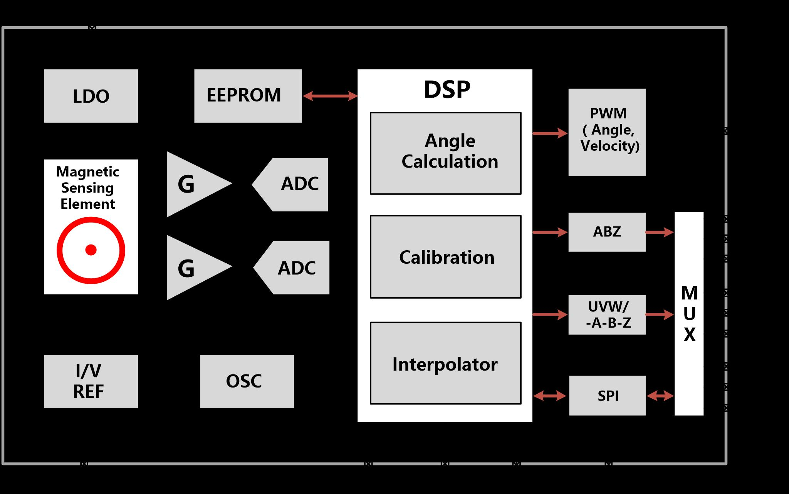

## 第 5 页

| MT6835 21位高分辨率、高精度磁性角度编码器IC 3. 极限参数(非正常工作条件) 以下所标称的芯片极限承受条件，不是芯片的正常工作条件范围，而是确保芯片不被损坏的极 限条件。任何超过“极限条件”所罗的列参数情况，将可能导致芯片的永久性损坏。 参数 最小值 最大值 单位 说明 电源电压 -0.5 6.5 V ABZ, UVW, MISO, MOSI, SCK, CSN, 管脚输入电压范围 -0.5 VDD V TEST_EN, OUT, CAL_EN, TEST管脚 管脚输出电流 -20 20 mA ABZ, UVW, OUT, MISO管脚 存储温度 -40 150 ℃ 防闩锁能力（闩锁输入电流） - ±100 mA 参考规范：AEC-Q100-004 静电防护能力（人体放电模式） - ±8.0 kV 参考规范：AEC-Q100-002 静电防护能力（元件充电模式） - ±1.5 kV 参考规范：AEC-Q100-011 4. 正常工作条件 参数 最小值 最大值 单位 电源电压 3.0 5.5 V 磁场强度 30 1,000 mT 转速 - 120,000 RPM(转/分钟) 工作温度 -40 125 ℃ |
| --- |
| www.magntek.com.cn \| 磁技术带来美妙变革 5 1.3版 2022年12月 |

| 参数 | 最小值 | 最大值 | 单位 | 说明 |
| --- | --- | --- | --- | --- |
| 电源电压 | -0.5 | 6.5 | V |  |
| 管脚输入电压范围 | -0.5 | VDD | V | ABZ, UVW, MISO, MOSI, SCK, CSN, TEST_EN, OUT, CAL_EN, TEST管脚 |
| 管脚输出电流 | -20 | 20 | mA | ABZ, UVW, OUT, MISO管脚 |
| 存储温度 | -40 | 150 | ℃ |  |
| 防闩锁能力（闩锁输入电流） | - | ±100 | mA | 参考规范：AEC-Q100-004 |
| 静电防护能力（人体放电模式） | - | ±8.0 | kV | 参考规范：AEC-Q100-002 |
| 静电防护能力（元件充电模式） | - | ±1.5 | kV | 参考规范：AEC-Q100-011 |

| 参数 | 最小值 | 最大值 | 单位 |
| --- | --- | --- | --- |
| 电源电压 | 3.0 | 5.5 | V |
| 磁场强度 | 30 | 1,000 | mT |
| 转速 | - | 120,000 | RPM(转/分钟) |
| 工作温度 | -40 | 125 | ℃ |

## 第 6 页

| MT6835 21位高分辨率、高精度磁性角度编码器IC 5. 电气性能参数 除非特殊说明，否则以下所有参数均为芯片工作在电源电压4.5~5.5V、温度在-40~125℃的区间内。 参数 描述 条件 最小值 典型 最大值 单位 VDD 电源电压 - 3.0 3.3~5.0 5.5 V Idd 芯片工作电流 - 15 22 28 mA LSB 最小分辨率 (ABZ模式) N步每圈 - 360°/N - ° 出厂校准后的积分非线性 注释[1] - ±0.5 ±1.0 ° INL 客户端自校准后的积分非线性 注释[2] ±0.07 ° DNL 差分非线性（图-3） @2500脉冲ABZ模式 - ±0.005 - ° 在25℃下； °rms TN 瞬态噪声（ABZ模式） - 0.0015 - 寄存器'BW’=5 Hyst 迟滞窗口 多档可编程 - 0.044 - ° T 系统上电准备时间（图-7） 电源上电<100微秒 - 2 - ms PwrUp T 系统延时 匀速情况下 - 10 - us Delay T 阶跃响应时间 寄存器 ‘BW’=5 - 100 - us ST 注释[1]: 这里的典型值，是在25℃磁铁和芯片没有偏心的情况下得到的。而最大值是在-40~125℃全温 范围内，在最大的芯片和磁铁的允许间隙（AG）以及最大允许的偏心（DISP）情况下测到的。 注释[2]: 关于客户端自校准的具体描述，请参考第9章。 图-3 : INL, DNL，瞬态噪声图示（ABZ 10位分辨率模式下) |
| --- |
| www.magntek.com.cn \| 磁技术带来美妙变革 6 1.3版 2022年12月 |

| 参数 | 描述 | 条件 | 最小值 | 典型 | 最大值 | 单位 |
| --- | --- | --- | --- | --- | --- | --- |
| VDD | 电源电压 | - | 3.0 | 3.3~5.0 | 5.5 | V |
| Idd | 芯片工作电流 | - | 15 | 22 | 28 | mA |
| LSB | 最小分辨率 (ABZ模式) | N步每圈 | - | 360°/N | - | ° |
| INL | 出厂校准后的积分非线性 | 注释[1] | - | ±0.5 | ±1.0 | ° |
|  | 客户端自校准后的积分非线性 | 注释[2] |  | ±0.07 |  | ° |
| DNL | 差分非线性（图-3） | @2500脉冲ABZ模式 | - | ±0.005 | - | ° |
| TN | 瞬态噪声（ABZ模式） | 在25℃下； 寄存器'BW’=5 | - | 0.0015 | - | °rms |
| Hyst | 迟滞窗口 | 多档可编程 | - | 0.044 | - | ° |
| T PwrUp | 系统上电准备时间（图-7） | 电源上电<100微秒 | - | 2 | - | ms |
| T Delay | 系统延时 | 匀速情况下 | - | 10 | - | us |
| T ST | 阶跃响应时间 | 寄存器 ‘BW’=5 | - | 100 | - | us |

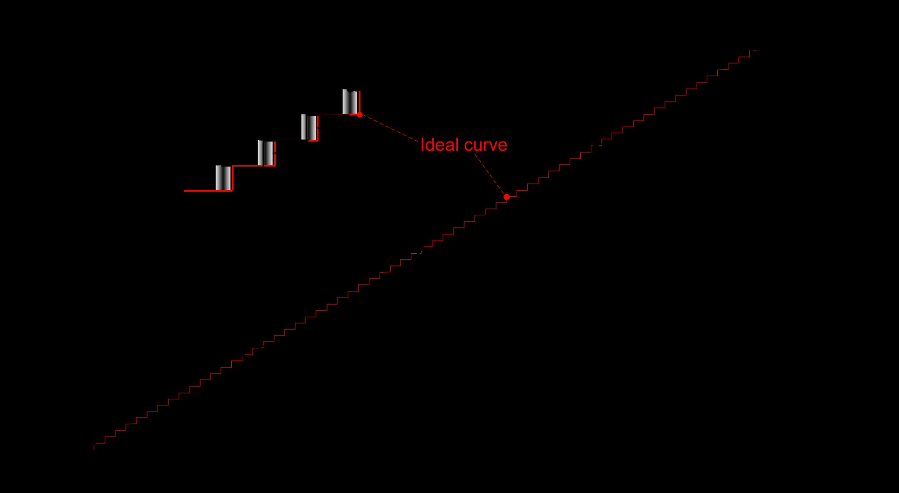

## 第 7 页

| MT6835 21位高分辨率、高精度磁性角度编码器IC l ABZ 输出参数 除非特殊说明，否则以下所有参数均为芯片工作在电源电压4.5~5.5V、温度在-40~125℃的区间内。 参数 描述 条件 最小 典型值 最大 单位 AB AB分辨率 可编程 1 - 16,384 脉冲/圈 RES AB A或B频率 注释(3) - - 2.048 MHz Freq 注释(3): AB编码输出的频率AB 是转速RS和AB分辨率AB 的乘积。 所以，当AB分辨率配置为最高的 Freq RES 16,384脉冲/圈时，系统可支持的最高转速为： AB 2.048MHz RS  Freq  125Hz  7,500RPM MAX AB 16,384 Res MT6835输出AB波形的最大频率实际上可以>2MHz，但是超过2MHz后，输出AB信号的INL就会下降。 l PWM 输出参数 除非特殊说明，否则以下所有参数均为芯片工作在电源电压4.5~5.5V、温度在-40~125℃的区间内。 参数 描述 条件 最小 典型值 最大 单位 F PWM频率 可编程 -8% 497或994 +8% Hz PWM T 上升沿时间 负载C =1nF - - 1 us Rise L T 下降沿时间 负载C =1nF - - 1 us Fall L l EEPROM 电气性能 除非特殊说明，否则以下所有参数均为芯片工作在电源电压4.5~5.5V、温度在-40~125℃的区间内。 参数 说明 最小值 典型值 最大值 单位 VDD 擦写和读取时的供电电压 3.0 - 5.5 V Endurance 擦写次数 1,000 - - 次 Retention 数据保存时间@150℃ 10 - -- 年 |
| --- |
| www.magntek.com.cn \| 磁技术带来美妙变革 7 1.3版 2022年12月 |

| 参数 | 描述 | 条件 | 最小 | 典型值 | 最大 | 单位 |
| --- | --- | --- | --- | --- | --- | --- |
| AB RES | AB分辨率 | 可编程 | 1 | - | 16,384 | 脉冲/圈 |
| AB Freq | A或B频率 | 注释(3) | - | - | 2.048 | MHz |

| 参数 | 描述 | 条件 | 最小 | 典型值 | 最大 | 单位 |
| --- | --- | --- | --- | --- | --- | --- |
| F PWM | PWM频率 | 可编程 | -8% | 497或994 | +8% | Hz |
| T Rise | 上升沿时间 | 负载C =1nF L | - | - | 1 | us |
| T Fall | 下降沿时间 | 负载C =1nF L | - | - | 1 | us |

| 参数 | 说明 | 最小值 | 典型值 | 最大值 | 单位 |
| --- | --- | --- | --- | --- | --- |
| VDD | 擦写和读取时的供电电压 | 3.0 | - | 5.5 | V |
| Endurance | 擦写次数 | 1,000 | - | - | 次 |
| Retention | 数据保存时间@150℃ | 10 | - | -- | 年 |

## 第 8 页

| MT6835 21位高分辨率、高精度磁性角度编码器IC l 通用数字I/O特性 除非特殊说明，否则以下所有参数均为芯片工作在电源电压4.5~5.5V、温度在-40~125℃的区间内。 参数 说明 条件 最小值 典型值 最大值 单位 数字I/O输入逻辑高电平 V - 0.8*VDD - - V IH (CSN, MOSI, CLK, CAL_EN) 数字I/O输入逻辑低电平 V - - - 0.2*VDD V IL (CSN, MOSI, CLK, CAL_EN) 数字I/O输出逻辑高电平 V 推挽输出 (@Iout=-2mA) VDD-0.4 - - V OH (ABZ, UVW, MISO，OUT) 数字I/O输出逻辑低电平 V 推挽输出 (@Iout=2mA) - - 0.4 V OL (ABZ, UVW, MISO, OUT) T 上升沿时间 C =20pf - - 50 ns Rise L T 下降沿时间 C =20pf - - 50 ns Fall L |
| --- |
| www.magntek.com.cn \| 磁技术带来美妙变革 8 1.3版 2022年12月 |

| 参数 | 说明 | 条件 | 最小值 | 典型值 | 最大值 | 单位 |
| --- | --- | --- | --- | --- | --- | --- |
| V IH | 数字I/O输入逻辑高电平 (CSN, MOSI, CLK, CAL_EN) | - | 0.8*VDD | - | - | V |
| V IL | 数字I/O输入逻辑低电平 (CSN, MOSI, CLK, CAL_EN) | - | - | - | 0.2*VDD | V |
| V OH | 数字I/O输出逻辑高电平 (ABZ, UVW, MISO，OUT) | 推挽输出 (@Iout=-2mA) | VDD-0.4 | - | - | V |
| V OL | 数字I/O输出逻辑低电平 (ABZ, UVW, MISO, OUT) | 推挽输出 (@Iout=2mA) | - | - | 0.4 | V |
| T Rise | 上升沿时间 | C =20pf L | - | - | 50 | ns |
| T Fall | 下降沿时间 | C =20pf L | - | - | 50 | ns |

## 第 9 页

| MT6835 21位高分辨率、高精度磁性角度编码器IC 6. 外加磁场参数 除非特别注明，否则以下所有参数均为芯片工作在电源电压3.0~5.5V、温度在-40~125℃的区间内， 外加1对极径向充磁的圆柱形磁铁的情况。 参数 说明 条件 最小 典型值 最大 单位 推荐直径10mm的1对极 Dmag 磁铁直径 - 10 - mm 径向充磁磁铁 Tmag 磁铁厚度 推荐磁铁厚度2.5mm - 2.5 - mm 输入磁场大小（平行于 Bpk 在芯片表面测得的 30 - 1,000 mT 芯片表面的水平方向） AG 间隙 芯片表面和磁铁的距离 - 1.0 3.0 mm RS 转速 - - 120,000 RPM(转/分钟) 磁体中心和芯片感应中 DISP 偏心 - - 0.3 mm 心的偏差（如图-4） TCmag1 钕铁硼磁铁 - -0.12 - 磁铁的温度系数 %/℃ TCmag2 钐钴磁铁 - -0.035 - 图-4: 磁铁的安装 |
| --- |
| www.magntek.com.cn \| 磁技术带来美妙变革 9 1.3版 2022年12月 |

| 参数 | 说明 | 条件 | 最小 | 典型值 | 最大 | 单位 |
| --- | --- | --- | --- | --- | --- | --- |
| Dmag | 磁铁直径 | 推荐直径10mm的1对极 径向充磁磁铁 | - | 10 | - | mm |
| Tmag | 磁铁厚度 | 推荐磁铁厚度2.5mm | - | 2.5 | - | mm |
| Bpk | 输入磁场大小（平行于 芯片表面的水平方向） | 在芯片表面测得的 | 30 | - | 1,000 | mT |
| AG | 间隙 | 芯片表面和磁铁的距离 | - | 1.0 | 3.0 | mm |
| RS | 转速 |  | - | - | 120,000 | RPM(转/分钟) |
| DISP | 偏心 | 磁体中心和芯片感应中 心的偏差（如图-4） | - | - | 0.3 | mm |
| TCmag1 | 磁铁的温度系数 | 钕铁硼磁铁 | - | -0.12 | - | %/℃ |
| TCmag2 |  | 钐钴磁铁 | - | -0.035 | - |  |

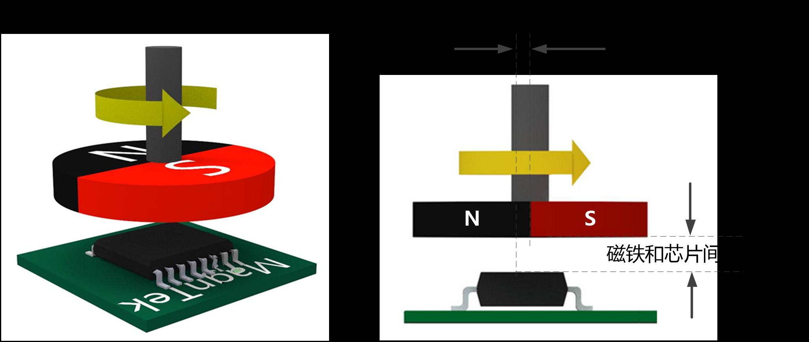

## 第 10 页

| MT6835 21位高分辨率、高精度磁性角度编码器IC 7. 输出模式 MT6835直接在对应的引脚输出ABZ，UVW和PWM信号，同时21位的绝对角度数据可以通过4线 SPI的专用引脚读取。 7.1 I/O引脚功能配置 MT6835提供的ABZ单端、ABZ差分，UVW、PWM以及SPI接口的引脚配置如下表 I/O 引脚配置表 引脚序号 UVW+SPI+PWM+ABZ -A-B-Z+SPI+PWM+ABZ 1 U -A 2 V -B 3 W -Z 5 MISO MISO 6 MOSI MOSI 7 SCK SCK 8 CSN CSN 10 OUT(PWM) OUT(PWM) 14 Z Z 15 B B 16 A A |
| --- |
| www.magntek.com.cn \| 磁技术带来美妙变革 10 1.3版 2022年12月 |

| 引脚序号 | UVW+SPI+PWM+ABZ | -A-B-Z+SPI+PWM+ABZ |
| --- | --- | --- |
| 1 | U | -A |
| 2 | V | -B |
| 3 | W | -Z |
| 5 | MISO | MISO |
| 6 | MOSI | MOSI |
| 7 | SCK | SCK |
| 8 | CSN | CSN |
| 10 | OUT(PWM) | OUT(PWM) |
| 14 | Z | Z |
| 15 | B | B |
| 16 | A | A |

## 第 11 页

| MT6835 21位高分辨率、高精度磁性角度编码器IC 7.2 参考电路 MT6835芯片由单一电源供电（3.3~5.0V），推荐在芯片电源和地引脚之间接一个不小于0.1uf 的去耦电容。为了更好的抗EMC表现，我们强烈推荐在芯片电源和地之间接一个TVS管。默认推荐参 考电路如图-5（客户端不做自校准）。MT6835，Pin.4（CAL_EN）和Pin.13（TEST）有内置的 250KΩ下拉电阻。 M aster U 1 16 A V 2 15 B W 3 14 Z 4 13 MISO 250K 250K 5 12 H O ST M C U MOSI 0.1uf 6 11 TVS(6V) SCK 7 10 PWM CSN 8 9 VDD 图-5: 参考电路（客户端不做自校准） 客户端如需做自校准，请参考下面图-6中推荐的参考电路，关于客户端自校准的操作请参考9.2章节。 M aster U 1 16 A V 2 15 B W 3 14 Z CAL_EN 4 13 MISO 250K 250K 5 12 H O ST M C U MOSI 0.1uf 6 11 TVS(6V) SCK 7 10 PWM CSN 8 9 VDD 图-6: 参考电路（客户端做自校准） |
| --- |
| www.magntek.com.cn \| 磁技术带来美妙变革 11 1.3版 2022年12月 |

| 250K 250K |  |
| --- | --- |

|  | 1 |
| --- | --- |

| 16 |  |
| --- | --- |

|  | 2 |
| --- | --- |

| 15 |  |
| --- | --- |

|  | 3 |
| --- | --- |

| 14 |  |
| --- | --- |

|  | 4 |
| --- | --- |

| 13 |  |
| --- | --- |

|  | 5 |
| --- | --- |

| 12 |  |
| --- | --- |

|  | 6 |
| --- | --- |

| 11 |  |
| --- | --- |

|  | 7 |
| --- | --- |

| 10 |  |
| --- | --- |

|  | 8 |
| --- | --- |

| 9 |  |
| --- | --- |

| 250K 250K |  |
| --- | --- |

|  | 1 |
| --- | --- |

| 16 |  |
| --- | --- |

|  | 2 |
| --- | --- |

| 15 |  |
| --- | --- |

|  | 3 |
| --- | --- |

| 14 |  |
| --- | --- |

|  | 4 |
| --- | --- |

| 13 |  |
| --- | --- |

|  | 5 |
| --- | --- |

| 12 |  |
| --- | --- |

|  | 6 |
| --- | --- |

| 11 |  |
| --- | --- |

|  | 7 |
| --- | --- |

| 10 |  |
| --- | --- |

|  | 8 |
| --- | --- |

| 9 |  |
| --- | --- |

## 第 12 页

| MT6835 21位高分辨率、高精度磁性角度编码器IC 7.3 正交A、B和零位Z信号输出(ABZ模式) 如图-7所示，当位于芯片正上方的磁铁（俯视）逆时针（CCW）转动时，B信号的上升沿领先 于A信号的上升沿1/4周期，反之当顺时针（CW）转动时，A信号的上升沿领先B信号的上升沿1/4 个周期。Z信号出现的位置代表0°的位置。在芯片上电以后的64ms以内是没有任何ABZ信号输出的， 64ms以后，芯片才会输出稳定正确的ABZ信号。 图-7: ABZ输出模式 转动方向寄存器‘ROT_DIR’(EEPROM) Reg. ROT_DIR 转动方向 0x0 磁铁在芯片上方逆时针转动（俯视）B领先A 0x1 磁铁在芯片上方顺时针转动（俯视）B领先A ’ROT_DIR’ 转动方向寄存器，对所有角度输出（ABZ，UVW， PWM，SPI）都起作用 |
| --- |
| www.magntek.com.cn \| 磁技术带来美妙变革 12 1.3版 2022年12月 |

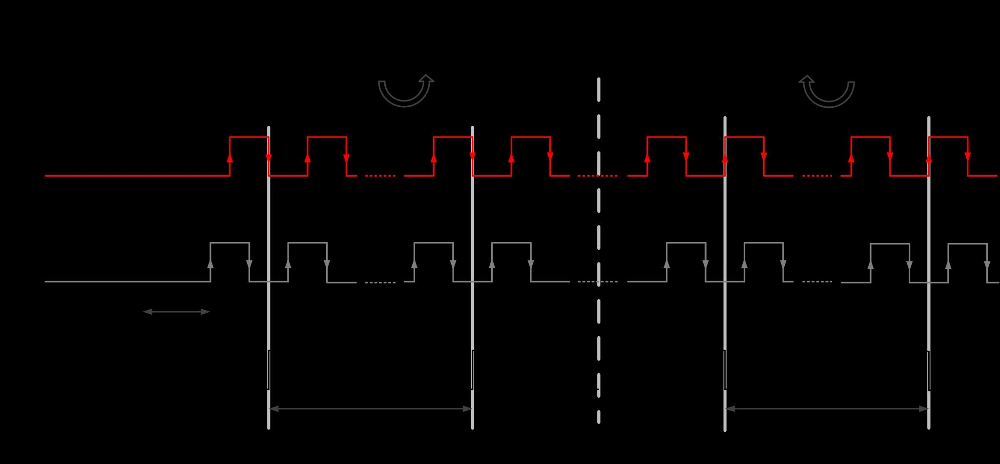

| Reg. ROT_DIR | 转动方向 |
| --- | --- |
| 0x0 | 磁铁在芯片上方逆时针转动（俯视）B领先A |
| 0x1 | 磁铁在芯片上方顺时针转动（俯视）B领先A |

## 第 13 页

| MT6835 21位高分辨率、高精度磁性角度编码器IC MT6835的ABZ输出，提供1~16,384脉冲/圈任意整数分辨率给客户自由编程。关于ABZ输出 分辨率常用的单位：位、步/圈、脉冲/圈的互相对应关系如图-8和图-9所示。 图-8: ABZ输出分辨率=16位=16,384脉冲/圈 图-9: ABZ 输出分辨率=10,000脉冲/圈 |
| --- |
| www.magntek.com.cn \| 磁技术带来美妙变革 13 1.3版 2022年12月 |

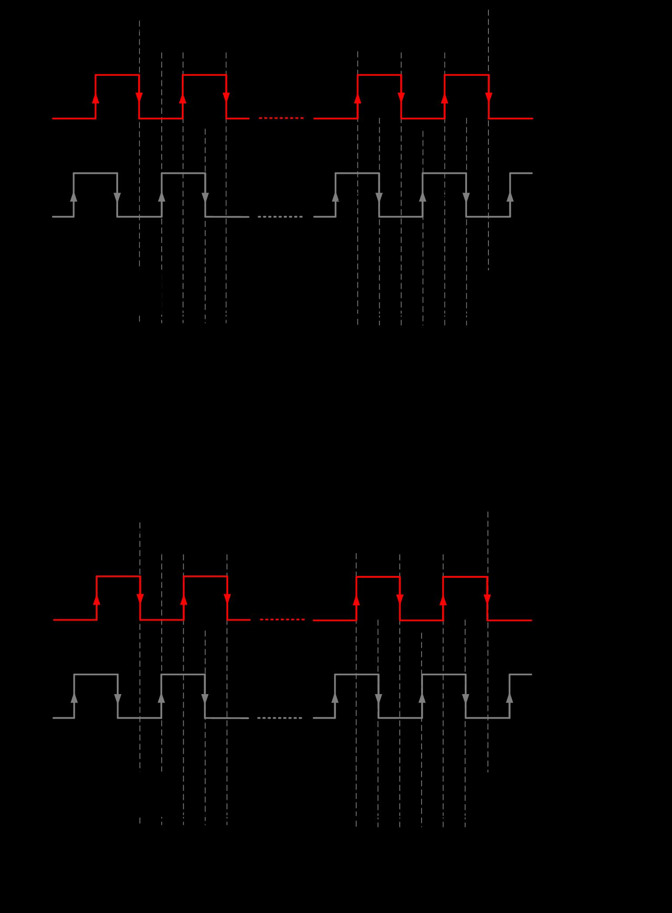

## 第 14 页

| MT6835 21位高分辨率、高精度磁性角度编码器IC ABZ输出分辨率由一个14比特位宽的寄存器‘ABZ_RES[13:0]’来定义; ABZ分辨率寄存器‘ABZ_RES[13:0]’ (EEPROM) Reg. ABZ_RES[13:0] ABZ分辨率 (脉冲/圈) 0x0000 1 0x0001 2 0x0002 3 . . . . . . 0x3FFC 16,381 0x3FFD 16,382 0x3FFE 16,383 0x3FFF 16,384 输出Z信号代表着角度绝对零位。Z信号的角度位置通过12比特的Z信号位置寄存器可自由编 程；Z信号宽度都是可以根据用户需要在1、2、4、8、16个LSB或者60°，120°，180°这些档位 中进行选择编程。Z信号每圈（配合一对极充磁磁铁工作）只出现一次。 图-10: Z信号宽度=1、2、4、8、16LSBs示意图 |
| --- |
| www.magntek.com.cn \| 磁技术带来美妙变革 14 1.3版 2022年12月 |

| Reg. ABZ_RES[13:0] | ABZ分辨率 (脉冲/圈) |
| --- | --- |
| 0x0000 | 1 |
| 0x0001 | 2 |
| 0x0002 | 3 |
| . . . | . . . |
| 0x3FFC | 16,381 |
| 0x3FFD | 16,382 |
| 0x3FFE | 16,383 |
| 0x3FFF | 16,384 |

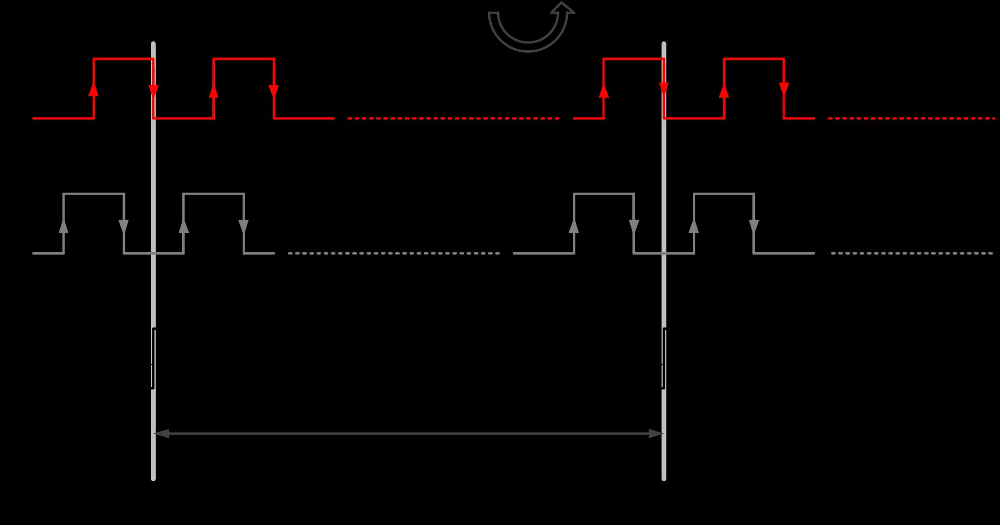

## 第 15 页

| MT6835 21位高分辨率、高精度磁性角度编码器IC 图-11: Z信号宽度=60°、120° 、180°示意图 Z信号的宽度由一个3比特位宽的寄存器‘Z_PUL_WID[2:0]’来定义，具体真值表如下; Z信号宽度寄存器‘Z_PUL_WID[2:0]’ (EEPROM） Reg. Z_PUL_WID[2:0] 宽度 (LSB或度) Reg. Z_PUL_WID[2:0] 宽度 (LSB或度) 0x0 1 0x4 16 0x1 2 0x5 60° 0x2 4 0x6 120° 0x3 8 0x7 180° Z信号的绝对角度位置由一个12比特位宽的寄存器‘ZERO_POS[11:0]’; Z信号角度位置寄存器‘ZERO_POS[11:0]’ (EEPROM) Reg. ZERO_POS[11:0] 绝对角度(度) 0x000 0 0x001 0.088 0x002 0.176 . . . . . . 0xFFE 359.824 0xFFF 359.912 |
| --- |
| www.magntek.com.cn \| 磁技术带来美妙变革 15 1.3版 2022年12月 |

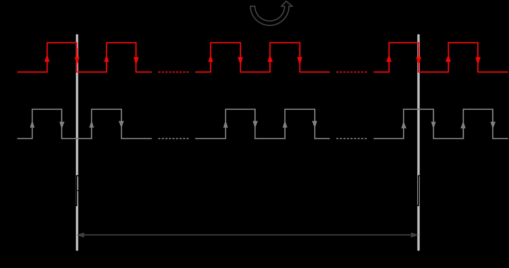

| Reg. Z_PUL_WID[2:0] | 宽度 (LSB或度) | Reg. Z_PUL_WID[2:0] | 宽度 (LSB或度) |
| --- | --- | --- | --- |
| 0x0 | 1 | 0x4 | 16 |
| 0x1 | 2 | 0x5 | 60° |
| 0x2 | 4 | 0x6 | 120° |
| 0x3 | 8 | 0x7 | 180° |

| Reg. ZERO_POS[11:0] | 绝对角度(度) |
| --- | --- |
| 0x000 | 0 |
| 0x001 | 0.088 |
| 0x002 | 0.176 |
| . . . | . . . |
| 0xFFE | 359.824 |
| 0xFFF | 359.912 |

## 第 16 页

| MT6835 21位高分辨率、高精度磁性角度编码器IC MT6835的Z信号相对于AB信号的相位，也可以由2比特位宽的‘Z_PHASE[1:0]’寄存器进行 编程控制，如图-12所示。 图-12: Z脉冲相位在寄存器‘ROT_DIR’=0 、‘SWAP_AB’=0、‘Z_EDGE’=0时的示意图 MT6835的Z脉冲的上升沿/下降沿和绝对0°的关系由寄存器 ‘Z_EDGE’控制。 Z脉冲沿控制寄存器‘Z_EDGE’(EEPROM) Reg. Z_EDGE 描述 0x0 Z脉冲上升沿和绝对零位对齐 0x1 Z脉冲下降沿和绝对零位对齐 图-13: Z 脉冲的沿和零位的关系 |
| --- |
| www.magntek.com.cn \| 磁技术带来美妙变革 16 1.3版 2022年12月 |

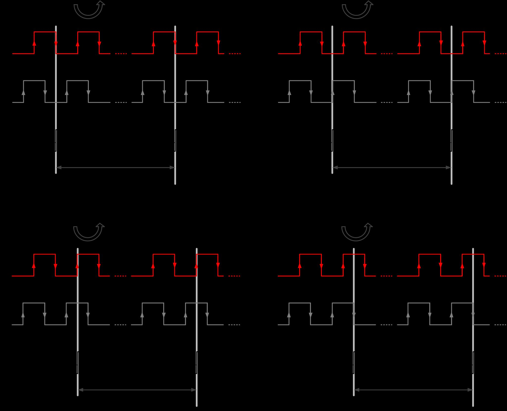

| Reg. Z_EDGE | 描述 |
| --- | --- |
| 0x0 | Z脉冲上升沿和绝对零位对齐 |
| 0x1 | Z脉冲下降沿和绝对零位对齐 |

## 第 17 页

| MT6835 21位高分辨率、高精度磁性角度编码器IC 7.4 UVW输出模式 MT6835提供互成120°的UVW输出，用以替代传统三颗开关霍尔进行的电机换相控制。UVW输 出如图-14所示。每一圈的UVW对极数可以由用户在1对极/圈~16对极/圈之间编程选择。 图-14: UVW输出波形 UVW分辨率对极数寄存器‘UVW_RES’ （EEPROM） Reg. UVW_RES[3:0] UVW 对极数（对极/圈） 0x0 1 0x1 2 0x2 3 0x3 4 0x4 5 0x5 6 0x6 7 0x7 8 0x8 9 0x9 10 0xA 11 0xB 12 0xC 13 0xD 14 0xE 15 0xF 16 |
| --- |
| www.magntek.com.cn \| 磁技术带来美妙变革 17 1.3版 2022年12月 |

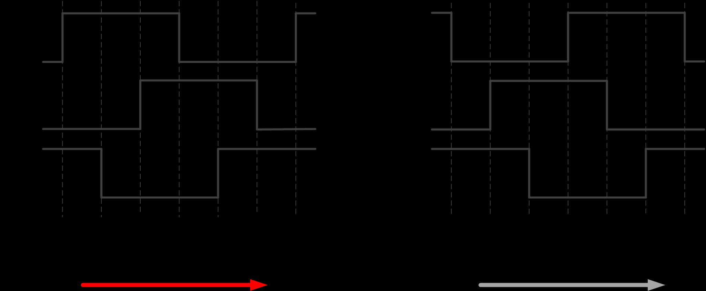

| Reg. UVW_RES[3:0] | UVW 对极数（对极/圈） |
| --- | --- |
| 0x0 | 1 |
| 0x1 | 2 |
| 0x2 | 3 |
| 0x3 | 4 |
| 0x4 | 5 |
| 0x5 | 6 |
| 0x6 | 7 |
| 0x7 | 8 |
| 0x8 | 9 |
| 0x9 | 10 |
| 0xA | 11 |
| 0xB | 12 |
| 0xC | 13 |
| 0xD | 14 |
| 0xE | 15 |
| 0xF | 16 |

## 第 18 页

| MT6835 21位高分辨率、高精度磁性角度编码器IC 7.5 PWM输出模式 MT6835除了提供增量ABZ模式和UVW模式，还同时提供了单线的12比特绝对值PWM输出模 式如图-15所示。PWM输出是引脚10的默认输出形式。 如图-15所示的PWM输出， PWM整个周期包含了4119个最小时钟周期。整个周期以固定的16 个最小时钟周期的高电平开始，以固定的8个最小时钟周期的低电平结束，中间是总长度是4095个 最小时钟周期的12比特角度数据（全0代表0°，全1代表359.x°）。PWM的最小时钟周期默认配置 是244纳秒，也可以根据客户需要更改为488纳秒。 MT6835除了可以通过PWM输出12比特的绝对角度数据外，还可以输出12比特的速度数据。 图-15: PWM输出 PWM频率选择寄存器‘PWM_FQ’(EEPROM) Reg. PWM_FQ PWM频率 0x0 994 Hz 0x1 497 Hz PWM输出内容选择寄存器‘PWM_SEL[2:0]’(EEPROM) Reg. PWM_SEL[2:0] PWM输出数据选择 0x0 12比特绝对角度 0x2 12比特速度 其他 出厂测试专用 |
| --- |
| www.magntek.com.cn \| 磁技术带来美妙变革 18 1.3版 2022年12月 |

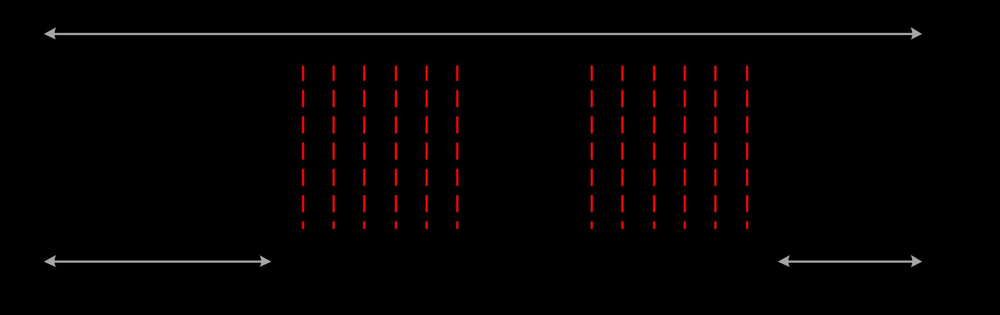

| Reg. PWM_FQ | PWM频率 |
| --- | --- |
| 0x0 | 994 Hz |
| 0x1 | 497 Hz |

| Reg. PWM_SEL[2:0] | PWM输出数据选择 |
| --- | --- |
| 0x0 | 12比特绝对角度 |
| 0x2 | 12比特速度 |
| 其他 | 出厂测试专用 |

## 第 19 页

| MT6835 21位高分辨率、高精度磁性角度编码器IC 7.6 SPI接口 MT6835提供了4线SPI接口，用户可以通过SPI接口读取芯片内部的21位绝对角度数据，也可 以通过SPI接口对相关寄存器进行配置，并将相关配置烧录进芯片内置的EEPROM。 7.6.1 SPI接口参考电路 如图-16展示了多颗MT6835并联使用SPI接口的参考电路图，单颗MT6835的参考电路请参见 图-5和图-6。 图-16: 4线SPI参考电路（多芯片并联） |
| --- |
| www.magntek.com.cn \| 磁技术带来美妙变革 19 1.3版 2022年12月 |

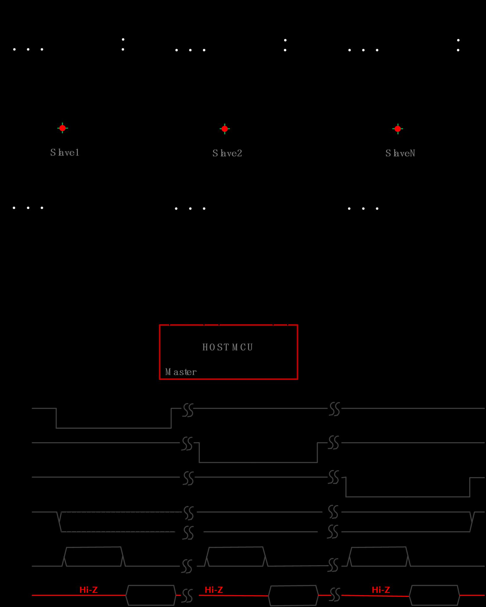

## 第 20 页

| MT6835 21位高分辨率、高精度磁性角度编码器IC 7.6.2 SPI时序 MT6835的SPI使用模式3（CPOL=1, CPHA=1）传输数据。如图-17所示，数据传输开始于 CSN的下降沿，结束于CSN的上升沿，MT6835在时钟上升沿采样数据。 图-17: SPI时序图 SPI时序参数 参数 描述 最小值 典型值 最大值 单位 T CSN下降沿到第一个时钟SCK下降沿的延时 100 - ns L T 时钟周期 60 - ns SCK T 时钟低电平时间 30 - ns SCKL T 时钟高电平时间 30 - ns SCKH T SCK时钟最后一个上升沿到CSN上升沿的延时 0.5•T - ns H SCK T 数字信号的上升沿 (有20pf的电容负载) - 10 - ns R T 数字信号的下降沿 (有20pf的电容负载) - 10 - ns F T MISO数据等待时间 (有20pf的电容负载) - - 15 ns DV T MOSI数据建立时间 10 - - ns ST T MOSI数据保持时间 10 - - ns HD |
| --- |
| www.magntek.com.cn \| 磁技术带来美妙变革 20 1.3版 2022年12月 |

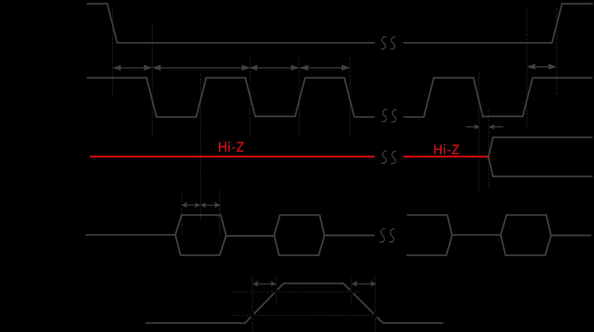

| 参数 | 描述 | 最小值 | 典型值 | 最大值 | 单位 |
| --- | --- | --- | --- | --- | --- |
| T L | CSN下降沿到第一个时钟SCK下降沿的延时 | 100 |  | - | ns |
| T SCK | 时钟周期 | 60 |  | - | ns |
| T SCKL | 时钟低电平时间 | 30 |  | - | ns |
| T SCKH | 时钟高电平时间 | 30 |  | - | ns |
| T H | SCK时钟最后一个上升沿到CSN上升沿的延时 | 0.5•T SCK |  | - | ns |
| T R | 数字信号的上升沿 (有20pf的电容负载) | - | 10 | - | ns |
| T F | 数字信号的下降沿 (有20pf的电容负载) | - | 10 | - | ns |
| T DV | MISO数据等待时间 (有20pf的电容负载) | - | - | 15 | ns |
| T ST | MOSI数据建立时间 | 10 | - | - | ns |
| T HD | MOSI数据保持时间 | 10 | - | - | ns |

## 第 21 页

| MT6835 21位高分辨率、高精度磁性角度编码器IC 7.6.3 SPI协议 图-18: 4线SPI协议时序 如图-18所示，MT6835的SPI通信由CSN使能信号控制；CSN的下降沿激活SPI通信，CSN的上升沿 结束SPI通信。SCK时钟信号由上位机发送给MT6835，MT6835最高可支持16MHz的SPI通信时钟，在 非通信状态下，请保持SCK为高电平； MOSI (上位机输出、MT6835输入) 和MISO (上位机输入、 MT6835输出) 是SPI接口的两路数据信号, 数据都是在时钟信号SCK的下降沿发生改变，所以推荐使用 SCK时钟信号的上升沿对数据进行采样；‘MISO’信号在非输出时将始终保持Hi-Z高阻状态。 比特1~4：SPI命令字段C3~C0真值表 C3~C0 命令操作 说明 0011 读寄存器 读MT6835寄存器的命令 0110 写寄存器 写MT6835寄存器的命令 1100 烧录EEPROM 将MT6835寄存器的值烧录进EEPROM（所有相关寄存器一起操作） 0101 自动设置零点寄存器 自动将当前的角度值写入零点寄存器（将当前位置设置为零点） 1010 连续读角度寄存器 连续读角度寄存器 其他 - - 比特 5~16： A11~A0是12比特位宽的寄存器地址，具体请参见第10章寄存器表； 比特17~24： 在写寄存器模式下，DI7~DI0是上位机写入到MT6835的8比特位宽的数据； 在读寄存器模式下，DO7~DO0是从MT6835读到的8比特位宽的数据； |
| --- |
| www.magntek.com.cn \| 磁技术带来美妙变革 21 1.3版 2022年12月 |

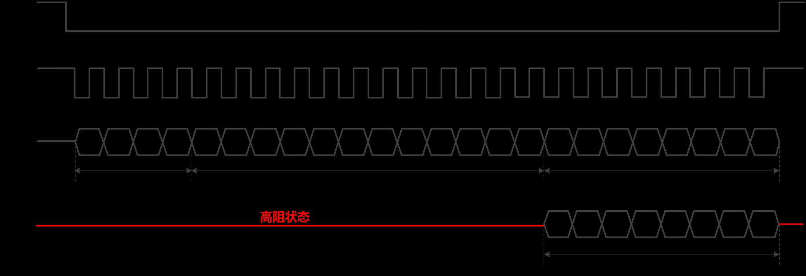

| C3~C0 | 命令操作 | 说明 |
| --- | --- | --- |
| 0011 | 读寄存器 | 读MT6835寄存器的命令 |
| 0110 | 写寄存器 | 写MT6835寄存器的命令 |
| 1100 | 烧录EEPROM | 将MT6835寄存器的值烧录进EEPROM（所有相关寄存器一起操作） |
| 0101 | 自动设置零点寄存器 | 自动将当前的角度值写入零点寄存器（将当前位置设置为零点） |
| 1010 | 连续读角度寄存器 | 连续读角度寄存器 |
| 其他 | - | - |

## 第 22 页

| MT6835 21位高分辨率、高精度磁性角度编码器IC 7.6.4 SPI单字节读寄存器 单字节读取MT6835内部的寄存器，使用SPI命令 C3~C0=‘0011’，相关寄存器地址A11~A0 及其真值表请参见第10章。 图-19: SPI单字节读寄存器 7.6.5 SPI单字节写寄存器 单字节写MT6835内部的寄存器，使用SPI命令 C3~C0=‘0110’，相关寄存器地址A11~A0及其 真值表请参见第10章。 图-20: SPI单字节写寄存器 |
| --- |
| www.magntek.com.cn \| 磁技术带来美妙变革 22 1.3版 2022年12月 |

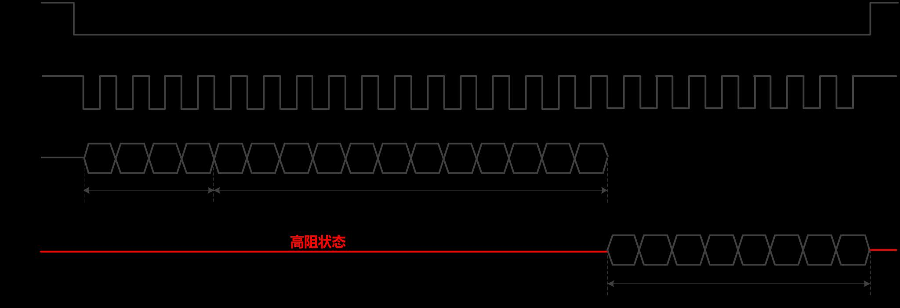

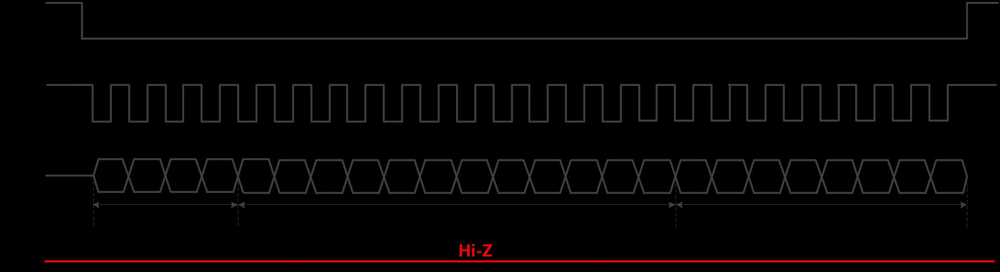

## 第 23 页

| MT6835 21位高分辨率、高精度磁性角度编码器IC 7.6.6 SPI烧录EEPROM 如图-21所示，对EEPROM进行烧录，请使用SPI命令 C3~C0=‘1100’，后面12位地址位全部输 入‘0’。MT6835如果正确接收到了该指令，会在MISO数据线上返回0x55的确认码，如返回任何其他 值，均表示指令接收失败。此命令一旦执行，所有在EEPROM中有映射地址的相关寄存器的数值都会被 写入EEPROM。EEPROM烧录指令发出后，请等待至少6秒，再给芯片断电，否则烧录可能会失败。 图-21: SPI烧录EEPROM操作 MT6835的寄存器表和EEPROM的关系如图-22所示，不是所有寄存器表中的数据都被映射到 EEPROM里去的，只有那些需要被存储保存的数据才被设计定义成可以存入EEPROM的，具体请参见第 10章有关寄存器的描述。每次芯片上电，存储在EEPROM的数据都会自动的导入到对应的寄存器表地址 中去，之后可以由客户自由通过SPI指令修改相应寄存器中的数值，如果这些客户想保存这些被修改的寄 存器值，可利用SPI烧录EEPROM的指令将其保存到EEPROM中。 图-22: 寄存器表和EEPROM关系 |
| --- |
| www.magntek.com.cn \| 磁技术带来美妙变革 23 1.3版 2022年12月 |

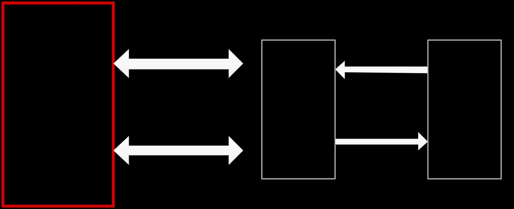

## 第 24 页

| MT6835 21位高分辨率、高精度磁性角度编码器IC 7.6.7 SPI 自动设置零点寄存器 MT6835提供了SPI自动设置当前角度到零点寄存器的专用指令如图-23所示，使用SPI命令 C3~C0=‘0101’，后面12位地址字段全部输入‘0’。MT6835如果正确接收到了该指令，会在MISO 数据线上返回0x55的确认码，如返回任何其他值，均表示指令接收失败。注意该操作只是将当前的角度 位置自动的写入’ZERO_POS[11:0]’寄存器，并没有烧录在EEPROM里，如果需要将此数据烧录进 EEPROM里（设置完零点后，至少等待1ms再烧录），请参考7.6.6章节中烧录EEPROM的操作。 图-23: SPI 自动设置零点寄存器命令操作 7.6.8 SPI单字节读取角度数据 用户可以按照图-24所示的SPI指令，分字节（每次SPI通信只读取一个字节的数据）将21位绝对 角度数据通过SPI从MT6835芯片中读取出来。MT6835提供给客户外部锁存当前角度数据的机制， 当SPI通信的片选信号CSN的下降沿被MT6835检测到的瞬间，内部角度寄存器0x003~0x006的数 据就被锁存住了，直到这些数据被读取走。 |
| --- |
| www.magntek.com.cn \| 磁技术带来美妙变革 24 1.3版 2022年12月 |

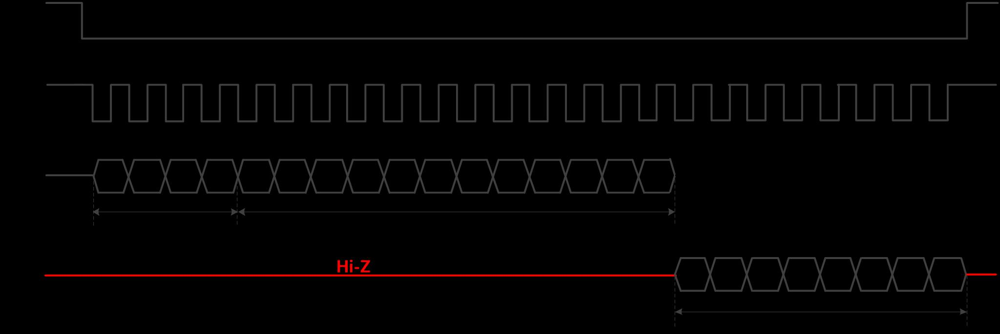

## 第 25 页

| MT6835 21位高分辨率、高精度磁性角度编码器IC 图-24: SPI 单字节读取角度寄存器 绝对角度寄存器‘ANGLE[20:0]’(只读) 地址 位7 位6 位5 位4 位3 位2 位1 位0 0x003 ANGLE[20:13] 0x004 ANGLE[12:5] 0x005 ANGLE[4:0] STATUS[2:0] 0x006 CRC[7:0] • 0~360° 绝对角度θ，可使用下面的公式计算： 20  ANGLE[i]2i = i0 360 221 报警状态寄存器‘STATUS[2:0]’(只读) STATUS[2:0] 说明 STATUS [0] 转速过快（超过12万转/分钟）报警，‘1’为报警，‘0’为正常 STATUS [1] 外加磁场太弱报警状态，‘1’为报警，‘0’为正常 STATUS [2] 芯片供电欠压报警，‘1’为报警，‘0’为正常 CRC校验的数据：ANGLE[20:0]和STATUS[2:0]总共24比特 CRC校验公式： X8+X2+X+1, ANGLE[20]作为最高位，最先移位进入 |
| --- |
| www.magntek.com.cn \| 磁技术带来美妙变革 25 1.3版 2022年12月 |

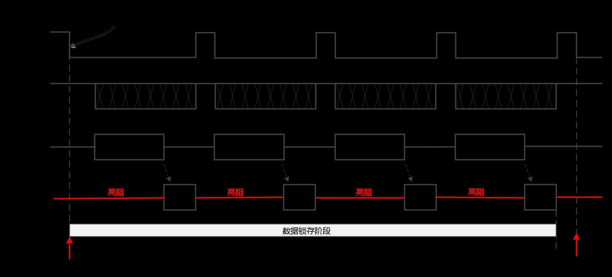

| 地址 | 位7 | 位6 | 位5 | 位4 | 位3 | 位2 | 位1 | 位0 |
| --- | --- | --- | --- | --- | --- | --- | --- | --- |
| 0x003 | ANGLE[20:13] |  |  |  |  |  |  |  |
| 0x004 | ANGLE[12:5] |  |  |  |  |  |  |  |
| 0x005 | ANGLE[4:0] |  |  |  |  | STATUS[2:0] |  |  |
| 0x006 | CRC[7:0] |  |  |  |  |  |  |  |

| STATUS[2:0] | 说明 |
| --- | --- |
| STATUS [0] | 转速过快（超过12万转/分钟）报警，‘1’为报警，‘0’为正常 |
| STATUS [1] | 外加磁场太弱报警状态，‘1’为报警，‘0’为正常 |
| STATUS [2] | 芯片供电欠压报警，‘1’为报警，‘0’为正常 |

## 第 26 页

| MT6835 21位高分辨率、高精度磁性角度编码器IC 7.6.9 SPI连续读角度数据 MT6835额外提供了SPI连续读取21位绝对角度数据的模式如图-25所示。连读数据的SPI命令是 C3~C0=‘1010’，上位机发送连读命令+0x003起始地址后，MT6835就会持续的返回寄存器 0x003~0x006的数据，直到通信被终止。 MT6835提供给客户外部锁存当前角度数据的机制，当SPI通信的片选信号CSN的下降沿被 MT6835检测到的瞬间，内部角度寄存器0x003~0x006的数据就被锁存住了，直到这些数据被读取走。 图-25: SPI 连读角度寄存器数据 |
| --- |
| www.magntek.com.cn \| 磁技术带来美妙变革 26 1.3版 2022年12月 |

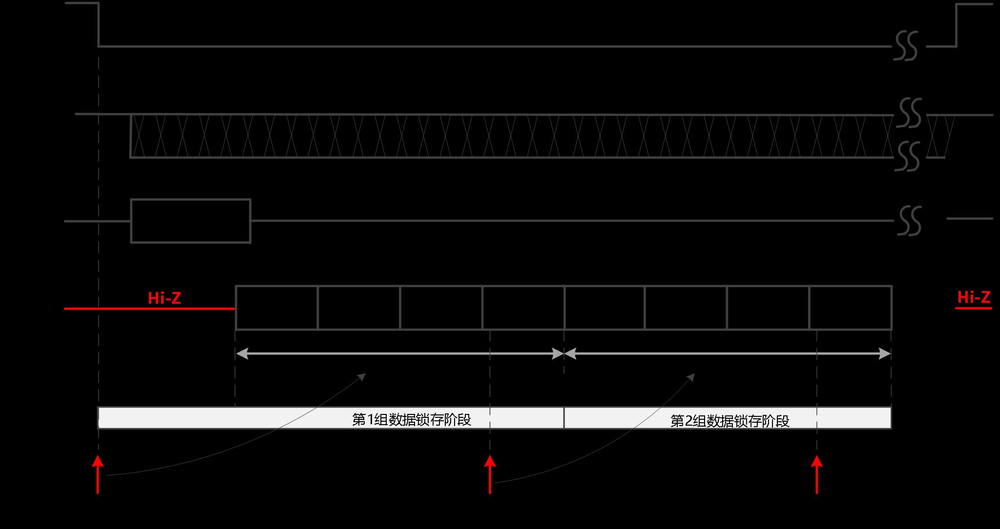

## 第 27 页

| MT6835 21位高分辨率、高精度磁性角度编码器IC 8. 设置零点寄存器并烧录进EEPROM MT6835的零点寄存器‘ZERO_POS[11:0]’定义了输出的角度数据的0°位置，零点寄存器的 地址和定义如下表。MT6835出厂默认配置的零点位置和1对极充磁磁铁的位置关系请参见第12章。 如图-26所示，MT6835提供了两种方式来修改零点寄存器 地址 位7 位6 位5 位4 位3 位2 位1 位0 类型 0x009 ZERO_POS[11:4] EEPROM 0x00A ZERO_POS[3:0] Z_EDGE Z_PUL_WID[2:0] EEPROM (1) 利用SPI自动设置零点寄存器‘ZERO_POS[11:0]’命令（参加7.6.7章节） 该指令仅可将当前物理角度值写入零点寄存器（没有烧录进EEPROM） (2) 手动计算零点并通过SPI指令写入零点寄存器‘ZERO_POS[11:0]’ (a) 首先通过SPI写入0x000到寄存‘ZERO_POS[11:0]’（清零该寄存器，以免干扰计算） (b) 通过SPI读寄存器命令，将当前的角度寄存器数据读取出来； (c) 计算目标零点的数值，通过SPI写寄存器指令写入‘ZERO_POS[11:0]’ ; 无论采用以上两种方法中的哪一种，如果要将零位寄存器的数值烧录进EEPROM，都需要额 外的一步通过SPI ‘烧录EEPROM’’ 的操作，具体请参见7.6.6章节。 图-26-1: 自动设置零点 图-26-2: 手动计算设置零点 |
| --- |
| www.magntek.com.cn \| 磁技术带来美妙变革 27 1.3版 2022年12月 |

| 地址 | 位7 | 位6 | 位5 | 位4 | 位3 | 位2 | 位1 | 位0 | 类型 |
| --- | --- | --- | --- | --- | --- | --- | --- | --- | --- |
| 0x009 | ZERO_POS[11:4] |  |  |  |  |  |  |  | EEPROM |
| 0x00A | ZERO_POS[3:0] |  |  |  | Z_EDGE | Z_PUL_WID[2:0] |  |  | EEPROM |

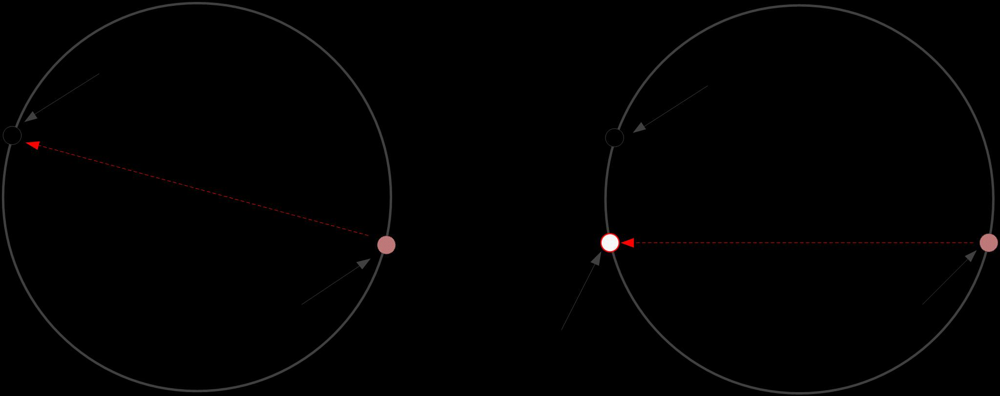

## 第 28 页

| MT6835 21位高分辨率、高精度磁性角度编码器IC 9. 校准 MT6835提供了总共三层校准机制：第一层是芯片的出厂基础校准，由MagnTek在交付给客户 之前完成；第二层是客户端的自动校准，在芯片磁铁等安装完毕后，由用户在系统稳定匀速运行状 态下，控制MT6835进行自动校准；最后第三层客户端NLC校准，需要将MT6835和一套高精度的 参考源对拖运行，将MT6835的角度数据和参考源的角度进行对比计算之后，再将相关参数写回 MT6835进行校准。 图-27: 三层校准 9.1 出厂校准 MT6835芯片在出厂之前都会完成基础的测试校准。如图-28所示，AMR磁阻元件的天然失调、 Sin/Cos之间的幅度误差以及相位误差都会在芯片的FT测试过程中被校准补偿，以确保出厂的 MT6835的INL<±0.5°（典型值）。 图-28: 失调,、幅度误差和相位误差 |
| --- |
| www.magntek.com.cn \| 磁技术带来美妙变革 28 1.3版 2022年12月 |

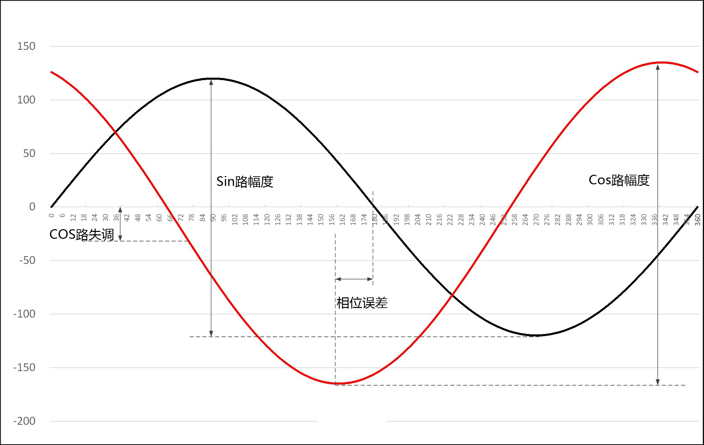

## 第 29 页

| MT6835 21位高分辨率、高精度磁性角度编码器IC 9.2 客户端自校准 MT6835提供了客户端自校准模式，自校准可以将磁铁偏差、芯片磁铁安装偏差所造成的非线 性进行补偿校准。自校准模式由4#引脚（CAL_EN）控制，首先让系统匀速运转，此时4#引脚由低 电平接到高电平时，MT6835就进入了自校准状态，MT6835自带的处理电路就会自动计算相关非 线性参数和校准，并将校准参数自动烧录进EEPROM。 在自校准成功运行后，典型情况下INL会减 小到±0.07°以下。具体的校准步骤和操作如下： (1) 配置自校准允许的转速区间。自校准可以被允许运行在不同的速度下，客户可以根据情况选择 希望使用的速度，并通过SPI接口配置AUTO_CAL_FREQ[2:0]寄存器，该寄存器出厂默认配置是 0x03（400转/分钟~800转/分钟）； 自校准速度区间寄存器‘AUTO_CAL_FREQ’(EEPROM) 寄存器：AUTO_CAL_FREQ[2:0] 自校准采用的速度区间（转/分钟） 0x0 3200≤速度<6400 0x1 1600≤速度<3200 0x2 800≤速度<1600 0x3 400 ≤速度< 800 0x4 200≤速度<400 0x5 100≤速度<200 0x6 50≤速度<100 0x7 25≤速度<50 (2) 将系统平稳的运行在目标转速； (3) 在系统已经平稳匀速运转的情况下，将引脚4接高电平进入自校准状态。保持这一速度继续运转 64圈以上。自校准的状态可以从PWM输出（引脚10）进行观测（在自校准模式下，PWM输出 将自动切换成自校准的状态）； PWM输出占空比 状态描述 50% 正在进行自校准 25% 自校准失败 >99% 自校准成功 另外自校准的状态也可以通过SPI接口从寄存器 0x113[7:6]读取: 0x113[7:6]=00, 没有运行校准; 0x113[7:6]=01, 正在进行自校准; 0x113[7:6]=10, 自校准失败; 0x113[7:6]=11, 自校准成功; (4) 如果自校准运行失败，请检查系统连接和配置，并重复上述步骤（1）~（3）; (5) 自校准成功完成后（等待>6秒钟），请务必给芯片断电； (6) 芯片重新上电后，才可以进行别的操作； |
| --- |
| www.magntek.com.cn \| 磁技术带来美妙变革 29 1.3版 2022年12月 |

| 寄存器：AUTO_CAL_FREQ[2:0] | 自校准采用的速度区间（转/分钟） |
| --- | --- |
| 0x0 | 3200≤速度<6400 |
| 0x1 | 1600≤速度<3200 |
| 0x2 | 800≤速度<1600 |
| 0x3 | 400 ≤速度< 800 |
| 0x4 | 200≤速度<400 |
| 0x5 | 100≤速度<200 |
| 0x6 | 50≤速度<100 |
| 0x7 | 25≤速度<50 |

| PWM输出占空比 | 状态描述 |
| --- | --- |
| 50% | 正在进行自校准 |
| 25% | 自校准失败 |
| >99% | 自校准成功 |

## 第 30 页

| MT6835 21位高分辨率、高精度磁性角度编码器IC 9.3 客户端非线性校准 MT6835除了出厂基础校准和客户端自校准之外，还提供了客户端非线性（NLC）校准。NLC校 准由一张256个点的查找表组成如图-29所示，每个点的数据都记录在MT6835的EEPROM中。一种推 荐的校准系统如图-30所示，两套互相连接的伺服系统，其中主拖电机安装的高性能光电编码器提供高 精度的参考角度数据供校准使用。 图-29: 客户端非线性校准 图-30: 一种推荐的客户端非线性校准对拖系统 |
| --- |
| www.magntek.com.cn \| 磁技术带来美妙变革 30 1.3版 2022年12月 |

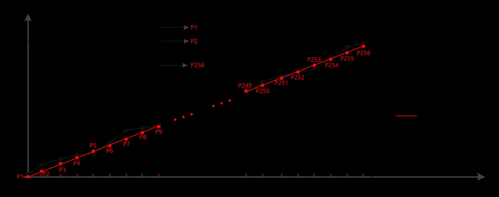

## 第 31 页

| MT6835 21位高分辨率、高精度磁性角度编码器IC 10. 寄存器表 地址 位7 位6 位5 位4 位3 位2 位1 位0 地址 0x001 USER_ID[7:0] EEPROM 0x002 Not Used NA 0x003 ANGLE[20:13] 只读 0x004 ANGLE[12:5] 只读 0x005 ANGLE[4:0] STATUS[2:0] 只读 0x006 CRC[7:0] 只读 0x007 ABZ_RES[13:6] EEPROM 0x008 ABZ_RES[5:0] ABZ_OFF AB_SWAP EEPROM 0x009 ZERO_POS[11:4] EEPROM 0x00A ZERO_POS[3:0] Z_EDGE Z_PUL_WID[2:0] EEPROM 0x00B Z_PHASE[1:0] UVW_MUX UVW_OFF UVW_RES[3:0] EEPROM 0x00C 仅供MagnTek使用 NLC_EN PWM_FQ PWM_POL PWM_SEL[2:0] EEPROM 0x00D 仅供MagnTek使用 ROT_DIR HYST[2:0] EEPROM 0x00E GPIO_DS AUTOCAL_FREQ[2:0] 仅供MagnTek使用 EEPROM 0x00F 仅供MagnTek使用 EEPROM 0x010 仅供MagnTek使用 EEPROM 0x011 仅供MagnTek使用 BW[2:0] EEPROM 0x012 仅供MagnTek使用 EEPROM 0x013 ~ NLC Byte 0x00~0xBF (Total 192 Bytes) EEPROM 0x0D2 提醒: 请避免有意、无意地更改那些标注为‘仅供MagnTek使用’ 的寄存器位，否则芯片肯能会变“砖头” (1) 0x001 客户保留寄存器(EEPROM) 地址 位7 位6 位5 位4 位3 位2 位1 位0 类型 0x001 USER_ID[7:0] EEPROM • ‘USER_ID[7:0]’寄存器是保留给客户任意使用的寄存器； |
| --- |
| www.magntek.com.cn \| 磁技术带来美妙变革 31 1.3版 2022年12月 |

| 地址 | 位7 | 位6 | 位5 | 位4 | 位3 | 位2 | 位1 | 位0 | 地址 |
| --- | --- | --- | --- | --- | --- | --- | --- | --- | --- |
| 0x001 | USER_ID[7:0] |  |  |  |  |  |  |  | EEPROM |
| 0x002 | Not Used |  |  |  |  |  |  |  | NA |
| 0x003 | ANGLE[20:13] |  |  |  |  |  |  |  | 只读 |
| 0x004 | ANGLE[12:5] |  |  |  |  |  |  |  | 只读 |
| 0x005 | ANGLE[4:0] |  |  |  |  | STATUS[2:0] |  |  | 只读 |
| 0x006 | CRC[7:0] |  |  |  |  |  |  |  | 只读 |
| 0x007 | ABZ_RES[13:6] |  |  |  |  |  |  |  | EEPROM |
| 0x008 | ABZ_RES[5:0] |  |  |  |  |  | ABZ_OFF | AB_SWAP | EEPROM |
| 0x009 | ZERO_POS[11:4] |  |  |  |  |  |  |  | EEPROM |
| 0x00A | ZERO_POS[3:0] |  |  |  | Z_EDGE | Z_PUL_WID[2:0] |  |  | EEPROM |
| 0x00B | Z_PHASE[1:0] |  | UVW_MUX | UVW_OFF | UVW_RES[3:0] |  |  |  | EEPROM |
| 0x00C | 仅供MagnTek使用 |  | NLC_EN | PWM_FQ | PWM_POL | PWM_SEL[2:0] |  |  | EEPROM |
| 0x00D | 仅供MagnTek使用 |  |  |  | ROT_DIR | HYST[2:0] |  |  | EEPROM |
| 0x00E | GPIO_DS | AUTOCAL_FREQ[2:0] |  |  | 仅供MagnTek使用 |  |  |  | EEPROM |
| 0x00F | 仅供MagnTek使用 |  |  |  |  |  |  |  | EEPROM |
| 0x010 | 仅供MagnTek使用 |  |  |  |  |  |  |  | EEPROM |
| 0x011 | 仅供MagnTek使用 |  |  |  |  | BW[2:0] |  |  | EEPROM |
| 0x012 | 仅供MagnTek使用 |  |  |  |  |  |  |  | EEPROM |
| 0x013 ~ 0x0D2 | NLC Byte 0x00~0xBF (Total 192 Bytes) |  |  |  |  |  |  |  | EEPROM |

| 地址 | 位7 | 位6 | 位5 | 位4 | 位3 | 位2 | 位1 | 位0 | 类型 |
| --- | --- | --- | --- | --- | --- | --- | --- | --- | --- |
| 0x001 | USER_ID[7:0] |  |  |  |  |  |  |  | EEPROM |

## 第 32 页

| MT6835 21位高分辨率、高精度磁性角度编码器IC (2) 0x003~ 0x006 角度数据寄存器(只读) 地址 位7 位6 位5 位4 位3 位2 位1 位0 类型 0x003 ANGLE[20:13] 只读 0x004 ANGLE[12:5] 只读 0x005 ANGLE[4:0] STATUS[2:0] 只读 0x006 CRC[7:0] 只读 • 0~360° 绝对角度θ，可使用下面的公式计算： 20  ANGLE[i]2i = i0 360 221 • ‘STATUS[2:0]’寄存器定义了3种系统报警状态； STATUS[2:0] 说明 STATUS [0] 转速过快（超过12万转/分钟）报警，‘1’为报警，‘0’为正常 STATUS [1] 外加磁场太弱报警状态，‘1’为报警，‘0’为正常 STATUS [2] 芯片供电欠压报警，‘1’为报警，‘0’为正常 • ‘CRC[7:0]’是8比特的校验位，校验范围包括ANGLE[20:0]和STATUS[2:0]总共24比特的数据， CRC校验公式为：X8+X2+X+1（ANGLE[20]作为最高位，最先移位进入）； (3) 0x007~ 0x008 ABZ分辨率及相关寄存器(EEPROM) 地址 位7 位6 位5 位4 位3 位2 位1 位0 0x007 ABZ_RES[13:6] 0x008 ABZ_RES[5:0] ABZ_OFF AB_SWAP • ‘ABZ_RES[13:0]’ 寄存器定义了AB输出的分辨率，有关分辨率定义请参考7.3章节; 寄存器：ABZ_RES[13:0] AB 分辨率 (脉冲/圈) 出厂默认配置 0x0000 1 √ 0x0001 2 … … … … 0x3FFE 16,383 0x3FFF 16,384 |
| --- |
| www.magntek.com.cn \| 磁技术带来美妙变革 32 1.3版 2022年12月 |

| 地址 | 位7 | 位6 | 位5 | 位4 | 位3 | 位2 | 位1 | 位0 | 类型 |
| --- | --- | --- | --- | --- | --- | --- | --- | --- | --- |
| 0x003 | ANGLE[20:13] |  |  |  |  |  |  |  | 只读 |
| 0x004 | ANGLE[12:5] |  |  |  |  |  |  |  | 只读 |
| 0x005 | ANGLE[4:0] |  |  |  |  | STATUS[2:0] |  |  | 只读 |
| 0x006 | CRC[7:0] |  |  |  |  |  |  |  | 只读 |

| STATUS[2:0] | 说明 |
| --- | --- |
| STATUS [0] | 转速过快（超过12万转/分钟）报警，‘1’为报警，‘0’为正常 |
| STATUS [1] | 外加磁场太弱报警状态，‘1’为报警，‘0’为正常 |
| STATUS [2] | 芯片供电欠压报警，‘1’为报警，‘0’为正常 |

| 地址 | 位7 | 位6 | 位5 | 位4 | 位3 | 位2 | 位1 | 位0 |
| --- | --- | --- | --- | --- | --- | --- | --- | --- |
| 0x007 | ABZ_RES[13:6] |  |  |  |  |  |  |  |
| 0x008 | ABZ_RES[5:0] |  |  |  |  |  | ABZ_OFF | AB_SWAP |

| 寄存器：ABZ_RES[13:0] | AB 分辨率 (脉冲/圈) | 出厂默认配置 |
| --- | --- | --- |
| 0x0000 | 1 | √ |
| 0x0001 | 2 |  |
| … … | … … |  |
| 0x3FFE | 16,383 |  |
| 0x3FFF | 16,384 |  |

## 第 33 页

| MT6835 21位高分辨率、高精度磁性角度编码器IC • ‘ABZ_OFF’ 寄存器定义了ABZ输出引脚的开关状态； 寄存器：ABZ_OFF ABZ输出引脚状态 出厂默认配置 0x0 开 √ 0x1 关 • ‘AB_SWAP’ 寄存器定义了A信号和B信号的互换关系 寄存器：AB_SWAP AB输出信号 出厂默认配置 0x0 不互换 √ 0x1 互换 (4) 0x009~ 0x00A Z脉冲相关寄存器(EEPROM) 地址 位7 位6 位5 位4 位3 位2 位1 位0 0x009 ZERO_POS[11:4] 0x00A ZERO_POS[3:0] Z_EDGE Z_PUL_WID[2:0] • ‘ZERO_POS[11:0]’ 寄存器定义了零点的位置，该数值对所有的角度输出类型均有效; 寄存器：ZERO_POS[11:0] 绝对角度值 (°) 出厂默认配置 0x000 0 √ 0x001 0.088 … … … … 0xFFE 359.824 0xFFF 359.912 • ‘Z_EDGE’ 寄存器定义了Z脉冲的上升/下降沿和角度零点的关系； 寄存器： Z_EDGE Z 脉冲的上升/下降沿和角度0°的关系 出厂默认配置 0x0 Z脉冲上升沿对准角度0° √ 0x1 Z脉冲下降沿对准角度0° |
| --- |
| www.magntek.com.cn \| 磁技术带来美妙变革 33 1.3版 2022年12月 |

| 寄存器：ABZ_OFF | ABZ输出引脚状态 | 出厂默认配置 |
| --- | --- | --- |
| 0x0 | 开 | √ |
| 0x1 | 关 |  |

| 寄存器：AB_SWAP | AB输出信号 | 出厂默认配置 |
| --- | --- | --- |
| 0x0 | 不互换 | √ |
| 0x1 | 互换 |  |

| 地址 | 位7 | 位6 | 位5 | 位4 | 位3 | 位2 | 位1 | 位0 |
| --- | --- | --- | --- | --- | --- | --- | --- | --- |
| 0x009 | ZERO_POS[11:4] |  |  |  |  |  |  |  |
| 0x00A | ZERO_POS[3:0] |  |  |  | Z_EDGE | Z_PUL_WID[2:0] |  |  |

| 寄存器：ZERO_POS[11:0] | 绝对角度值 (°) | 出厂默认配置 |
| --- | --- | --- |
| 0x000 | 0 | √ |
| 0x001 | 0.088 |  |
| … … | … … |  |
| 0xFFE | 359.824 |  |
| 0xFFF | 359.912 |  |

| 寄存器： Z_EDGE | Z 脉冲的上升/下降沿和角度0°的关系 | 出厂默认配置 |
| --- | --- | --- |
| 0x0 | Z脉冲上升沿对准角度0° | √ |
| 0x1 | Z脉冲下降沿对准角度0° |  |

## 第 34 页

| MT6835 21位高分辨率、高精度磁性角度编码器IC • ‘Z_PUL_WID[2:0]’定义了Z脉冲的宽度 寄存器： Z_PUL_WID[2:0] Width (LSBs/°) 出厂默认配置 0x0 1 √ 0x1 2 0x2 4 0x3 8 0x4 16 0x5 60° 0x6 120° 0x7 180° (5) 0x00B Z相位以及UVW分辨率寄存器(EEPROM) 地址 位7 位6 位5 位4 位3 位2 位1 位0 0x00B Z_PHASE[1:0] UVW_MUX UVW_OFF UVW_RES[3:0] • ‘Z_PHASE[1:0]’ 寄存器定义了Z脉冲和AB脉冲之间的相位关系，具体请参考图-12和图-13； • ‘UVW_MUX’寄存器定义了UVW引脚(1#~3#引脚) 是输出UVW信号还是-A-B-Z信号 ; 寄存器：UVW_MUX UVW 引脚输出信号 出厂默认配置 0x0 UVW √ 0x1 -A-B-Z • ‘UVW_OFF’寄存器定义了UVW输出引脚的开关状态（不用时可关闭，以减少干扰）； 寄存器：UVW_OFF UVW 引脚输出状态 出厂默认配置 0x0 开 √ 0x1 关 • ‘UVW_RES[3:0]’ 寄存器定义了UVW输出的分辨率对极数； 寄存器：UVW_RES[3:0] UVW P极对数 出厂默认配置 0x0 1 √ 0x1 2 … … … … 0xE 15 0xF 16 |
| --- |
| www.magntek.com.cn \| 磁技术带来美妙变革 34 1.3版 2022年12月 |

| 寄存器： Z_PUL_WID[2:0] | Width (LSBs/°) | 出厂默认配置 |
| --- | --- | --- |
| 0x0 | 1 | √ |
| 0x1 | 2 |  |
| 0x2 | 4 |  |
| 0x3 | 8 |  |
| 0x4 | 16 |  |
| 0x5 | 60° |  |
| 0x6 | 120° |  |
| 0x7 | 180° |  |

| 地址 | 位7 | 位6 | 位5 | 位4 | 位3 | 位2 | 位1 | 位0 |
| --- | --- | --- | --- | --- | --- | --- | --- | --- |
| 0x00B | Z_PHASE[1:0] |  | UVW_MUX | UVW_OFF | UVW_RES[3:0] |  |  |  |

| 寄存器：UVW_MUX | UVW 引脚输出信号 | 出厂默认配置 |
| --- | --- | --- |
| 0x0 | UVW | √ |
| 0x1 | -A-B-Z |  |

| 寄存器：UVW_OFF | UVW 引脚输出状态 | 出厂默认配置 |
| --- | --- | --- |
| 0x0 | 开 | √ |
| 0x1 | 关 |  |

| 寄存器：UVW_RES[3:0] | UVW P极对数 | 出厂默认配置 |
| --- | --- | --- |
| 0x0 | 1 | √ |
| 0x1 | 2 |  |
| … … | … … |  |
| 0xE | 15 |  |
| 0xF | 16 |  |

## 第 35 页

| MT6835 21位高分辨率、高精度磁性角度编码器IC (6) 0x00C PWM和NLC 校准相关寄存器 (EEPROM) 地址 位7 位6 位5 位4 位3 位2 位1 位0 0x00C 仅供MagnTek使用 NLC_EN PWM_FQ PWM_POL PWM_SEL[2:0] • ‘NLC_EN’ 寄存器可控制NLC校准的开启； 寄存器：NLC_EN NLC 校准 出厂默认配置 0x0 关闭 √ 0x1 开启 • ‘PWM_FQ’ 寄存器定义了PWM的频率； 寄存器：PWM_FQ PWM 频率 出厂默认配置 0x0 994 Hz √ 0x1 497 Hz • ‘PWM_POL’ 寄存器定义了PWM输出有效电平； 寄存器：PWM_POL PWM 极性 出厂默认配置 0x0 高电平有效 √ 0x1 低电平有效 • ‘PWM_SEL[2:0]’ 寄存器定义了PWM信号输出的内容； 寄存器：PWM_SEL[2:0] PWM 数据类型 出厂默认配置 0x0 12比特角度数据 √ 0x2 12比特速度数据 其他 工厂测试专用 (7) 0x00D (EEPROM) 地址 位7 位6 位5 位4 位3 位2 位1 位0 0x00D 仅供MagnTek使用 ROT_DIR HYST[2:0] • ‘ROT_DIR’寄存器定义了输出角度增加和转动方向的关系，请参见图-7； 寄存器：ROT_DIR 转动方向 出厂默认配置 0x0 逆时针（输出角度增加） √ 0x1 顺时针（输出角度增加） |
| --- |
| www.magntek.com.cn \| 磁技术带来美妙变革 35 1.3版 2022年12月 |

| 地址 | 位7 | 位6 | 位5 | 位4 | 位3 | 位2 | 位1 | 位0 |
| --- | --- | --- | --- | --- | --- | --- | --- | --- |
| 0x00C | 仅供MagnTek使用 |  | NLC_EN | PWM_FQ | PWM_POL | PWM_SEL[2:0] |  |  |

| 寄存器：NLC_EN | NLC 校准 | 出厂默认配置 |
| --- | --- | --- |
| 0x0 | 关闭 | √ |
| 0x1 | 开启 |  |

| 寄存器：PWM_FQ | PWM 频率 | 出厂默认配置 |
| --- | --- | --- |
| 0x0 | 994 Hz | √ |
| 0x1 | 497 Hz |  |

| 寄存器：PWM_POL | PWM 极性 | 出厂默认配置 |
| --- | --- | --- |
| 0x0 | 高电平有效 | √ |
| 0x1 | 低电平有效 |  |

| 寄存器：PWM_SEL[2:0] | PWM 数据类型 | 出厂默认配置 |
| --- | --- | --- |
| 0x0 | 12比特角度数据 | √ |
| 0x2 | 12比特速度数据 |  |
| 其他 | 工厂测试专用 |  |

| 地址 | 位7 | 位6 | 位5 | 位4 | 位3 | 位2 | 位1 | 位0 |
| --- | --- | --- | --- | --- | --- | --- | --- | --- |
| 0x00D | 仅供MagnTek使用 |  |  |  | ROT_DIR | HYST[2:0] |  |  |

| 寄存器：ROT_DIR | 转动方向 | 出厂默认配置 |
| --- | --- | --- |
| 0x0 | 逆时针（输出角度增加） | √ |
| 0x1 | 顺时针（输出角度增加） |  |

## 第 36 页

| MT6835 21位高分辨率、高精度磁性角度编码器IC • ‘HYST[2:0]’寄存器定义了角度输出的迟滞窗口； 寄存器： HYST[2:0] 迟滞窗口大小 出厂默认配置 0x0 0.022° 0x1 0.044° 0x2 0.088° 0x3 0.176° 0x4 0 0x5 0.003° 0x6 0.006° 0x7 0.011° √ (8) 0x00E (EEPROM) 地址 位7 位6 位5 位4 位3 位2 位1 位0 0x00E GPIO_DS AUTOCAL_FREQ[2:0] 仅供MagnTek使用 • ‘GPIO_DS’寄存器定义了通用I/O的输出驱动能力； 寄存器：GPIO_DS 通用I/O的输出驱动能力 出厂默认配置 0x0 默认驱动能力 √ 0x1 默认驱动能力x2 • ‘AUTOCAL_FREQ[2:0]’ 寄存器定义了客户端自校准所采用的转速区间； 寄存器：AUTO_CAL_FREQ[2:0] 自校准采用的速度区间（转/分钟） 出厂默认配置 0x0 3200≤速度<6400 0x1 1600≤速度<3200 0x2 800≤速度<1600 0x3 400 ≤速度< 800 √ 0x4 200≤速度<400 0x5 100≤速度<200 0x6 50≤速度<100 0x7 25≤速度<50 |
| --- |
| www.magntek.com.cn \| 磁技术带来美妙变革 36 1.3版 2022年12月 |

| 寄存器： HYST[2:0] | 迟滞窗口大小 | 出厂默认配置 |
| --- | --- | --- |
| 0x0 | 0.022° |  |
| 0x1 | 0.044° |  |
| 0x2 | 0.088° |  |
| 0x3 | 0.176° |  |
| 0x4 | 0 |  |
| 0x5 | 0.003° |  |
| 0x6 | 0.006° |  |
| 0x7 | 0.011° | √ |

| 地址 | 位7 | 位6 | 位5 | 位4 | 位3 | 位2 | 位1 | 位0 |
| --- | --- | --- | --- | --- | --- | --- | --- | --- |
| 0x00E | GPIO_DS | AUTOCAL_FREQ[2:0] |  |  | 仅供MagnTek使用 |  |  |  |

| 寄存器：GPIO_DS | 通用I/O的输出驱动能力 | 出厂默认配置 |
| --- | --- | --- |
| 0x0 | 默认驱动能力 | √ |
| 0x1 | 默认驱动能力x2 |  |

| 寄存器：AUTO_CAL_FREQ[2:0] | 自校准采用的速度区间（转/分钟） | 出厂默认配置 |
| --- | --- | --- |
| 0x0 | 3200≤速度<6400 |  |
| 0x1 | 1600≤速度<3200 |  |
| 0x2 | 800≤速度<1600 |  |
| 0x3 | 400 ≤速度< 800 | √ |
| 0x4 | 200≤速度<400 |  |
| 0x5 | 100≤速度<200 |  |
| 0x6 | 50≤速度<100 |  |
| 0x7 | 25≤速度<50 |  |

## 第 37 页

| MT6835 21位高分辨率、高精度磁性角度编码器IC (8) 0x011 系统带宽寄存器 (EEPROM) 地址 位7 位6 位5 位4 位3 位2 位1 位0 0x011 仅供MagnTek使用 BW [2:0] • ‘BW[2:0]’寄存器定义了MT6835的系统带宽； 寄存器：BW[2:0] 配置 速度影响 出厂默认设置 0x0 基础带宽 慢 (噪声小) 0x1 基础带宽 x 2 0x2 基础带宽 x 4 0x3 基础带宽 x 8 0x4 基础带宽 x 16 0x5 基础带宽 x 32 √ 0x6 基础带宽 x 64 0x7 基础带宽 x 128 快 (噪声大) |
| --- |
| www.magntek.com.cn \| 磁技术带来美妙变革 37 1.3版 2022年12月 |

| 地址 | 位7 | 位6 | 位5 | 位4 | 位3 | 位2 | 位1 | 位0 |
| --- | --- | --- | --- | --- | --- | --- | --- | --- |
| 0x011 | 仅供MagnTek使用 |  |  |  |  | BW [2:0] |  |  |

| 寄存器：BW[2:0] | 配置 | 速度影响 | 出厂默认设置 |
| --- | --- | --- | --- |
| 0x0 | 基础带宽 | 慢 (噪声小) |  |
| 0x1 | 基础带宽 x 2 |  |  |
| 0x2 | 基础带宽 x 4 |  |  |
| 0x3 | 基础带宽 x 8 |  |  |
| 0x4 | 基础带宽 x 16 |  |  |
| 0x5 | 基础带宽 x 32 |  | √ |
| 0x6 | 基础带宽 x 64 |  |  |
| 0x7 | 基础带宽 x 128 | 快 (噪声大) |  |

## 第 38 页

| MT6835 21位高分辨率、高精度磁性角度编码器IC 11. 磁铁安装要求 MT6835在安装使用过程中，磁铁的中心必须对准芯片的磁感应中心位置，磁铁距离芯片的距 离也要尽可能的小，以期获得最佳的性能。较大的安装间隙（AG）会减弱磁场，而磁铁和芯片的安 装偏心（DISP）会引入非线性，从而恶化INL的性能。如图-31所示（在没有自校准或NLC校准之 前） ，较大的偏心（DISP）和较大的间隙（AG）造成的INL恶化对直径较小的磁铁更加明显。 INL vs. 偏心（10mm磁铁） 0.8 0.7 0.6 0.5 )°(LNI AG=1mm 0.4 AG=2mm 0.3 AG=3mm 0.2 0.1 0 0 0.1 0.2 0.3 0.4 0.5 0.6 偏心 (mm) 图-31: INL vs. 偏心和间隙变化的表现（仅做了出厂校准） |
| --- |
| www.magntek.com.cn \| 磁技术带来美妙变革 38 1.3版 2022年12月 |

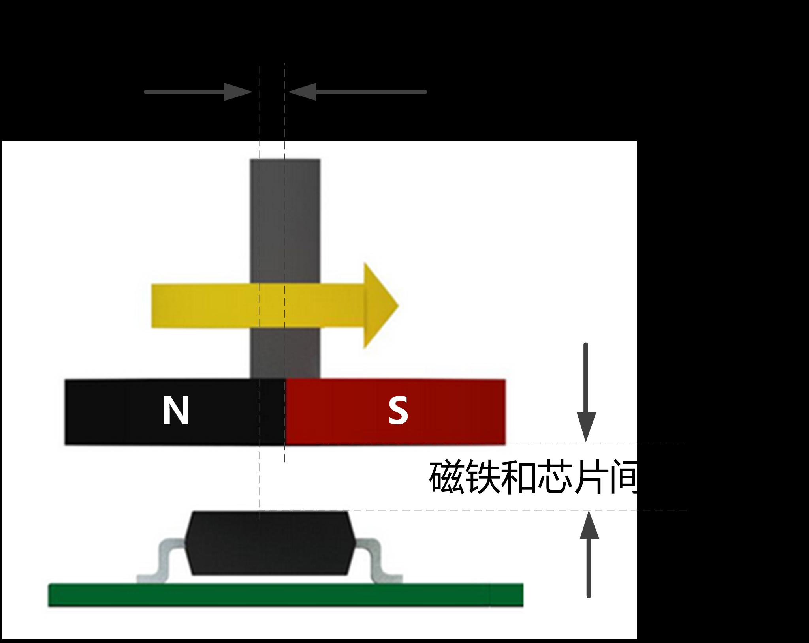

## 第 39 页

| MT6835 21位高分辨率、高精度磁性角度编码器IC 12. 机械角度和方向 俯视图 0 degree 90 degree 16 15 14 13 12 11 10 9 16 15 14 13 12 11 10 9 N N S S 1 2 3 4 5 6 7 8 1 2 3 4 5 6 7 8 180 degree 270 degree 16 15 14 13 12 11 10 9 16 15 14 13 12 11 10 9 S S N N 1 2 3 4 5 6 7 8 1 2 3 4 5 6 7 8 逆时针（CCW）旋转磁铁 （ 寄存器‘ROT-DIR’=0） |
| --- |
| www.magntek.com.cn \| 磁技术带来美妙变革 39 1.3版 2022年12月 |

| 16 |
| --- |

| 15 |
| --- |

| 14 |
| --- |

| 13 |
| --- |

| 12 |
| --- |

| 11 |
| --- |

| 10 |
| --- |

| 9 |
| --- |

| 16 |
| --- |

| 15 |
| --- |

| 14 |
| --- |

| 13 |
| --- |

| 11 |
| --- |

| 10 |
| --- |

| 9 |
| --- |

| N S |  |
| --- | --- |

| N S |  |
| --- | --- |

| 1 |
| --- |

| 2 |
| --- |

| 3 |
| --- |

| 4 |
| --- |

| 5 |
| --- |

| 6 |
| --- |

| 7 |
| --- |

| 8 |
| --- |

| 1 |
| --- |

| 2 |
| --- |

| 3 |
| --- |

| 4 |
| --- |

| 6 |
| --- |

| 7 |
| --- |

| 8 |
| --- |

| 16 |
| --- |

| 15 |
| --- |

| 14 |
| --- |

| 13 |
| --- |

| 12 |
| --- |

| 11 |
| --- |

| 10 |
| --- |

| 9 |
| --- |

| 16 |
| --- |

| 15 |
| --- |

| 14 |
| --- |

| 13 |
| --- |

| 11 |
| --- |

| 10 |
| --- |

| 9 |
| --- |

| S N |  |
| --- | --- |

| S N |  |
| --- | --- |

| 1 |
| --- |

| 2 |
| --- |

| 3 |
| --- |

| 4 |
| --- |

| 5 |
| --- |

| 6 |
| --- |

| 7 |
| --- |

| 8 |
| --- |

| 1 |
| --- |

| 2 |
| --- |

| 3 |
| --- |

| 4 |
| --- |

| 6 |
| --- |

| 7 |
| --- |

| 8 |
| --- |

## 第 40 页

| MT6835 21位高分辨率、高精度磁性角度编码器IC 13. 封装信息 Z Y X 尺寸（单位：毫米） 尺寸（单位：英寸） 符号 最小值 最大值 最小值 最大值 D 4.900 5.100 0.193 0.201 E 6.250 6.550 0.246 0.258 b 0.190 0.300 0.007 0.012 c 0.090 0.200 0.004 0.008 E1 4.300 4.500 0.169 0.177 A 1.200 0.047 A2 0.800 1.000 0.031 0.039 A1 0.050 0.150 0.002 0.006 e 0.65 (BSC) 0.026 (BSC) L 0.500 0.700 0.020 0.028 H 0.25 (TYP) 0.01 (TYP) θ 1° 7° 1° 7° X 2.450 2.550 0.097 0.101 Y 2.150 2.250 0.085 0.089 Z 0.210 0.370 0.016 0.024 |
| --- |
| www.magntek.com.cn \| 磁技术带来美妙变革 40 1.3版 2022年12月 |

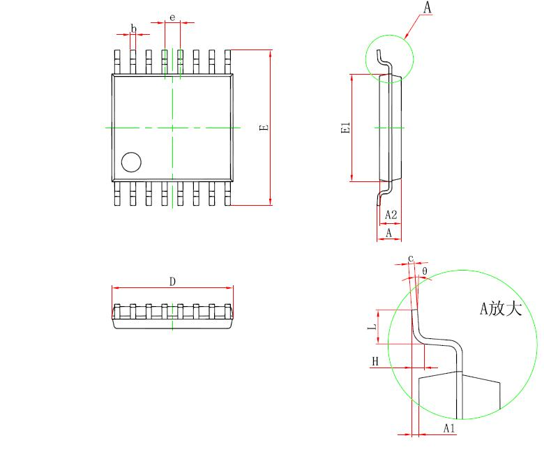

| 符号 | 尺寸（单位：毫米） |  | 尺寸（单位：英寸） |  |
| --- | --- | --- | --- | --- |
|  | 最小值 | 最大值 | 最小值 | 最大值 |
| D | 4.900 | 5.100 | 0.193 | 0.201 |
| E | 6.250 | 6.550 | 0.246 | 0.258 |
| b | 0.190 | 0.300 | 0.007 | 0.012 |
| c | 0.090 | 0.200 | 0.004 | 0.008 |
| E1 | 4.300 | 4.500 | 0.169 | 0.177 |
| A |  | 1.200 |  | 0.047 |
| A2 | 0.800 | 1.000 | 0.031 | 0.039 |
| A1 | 0.050 | 0.150 | 0.002 | 0.006 |
| e | 0.65 (BSC) |  | 0.026 (BSC) |  |
| L | 0.500 | 0.700 | 0.020 | 0.028 |
| H | 0.25 (TYP) |  | 0.01 (TYP) |  |
| θ | 1° | 7° | 1° | 7° |
| X | 2.450 | 2.550 | 0.097 | 0.101 |
| Y | 2.150 | 2.250 | 0.085 | 0.089 |
| Z | 0.210 | 0.370 | 0.016 | 0.024 |

## 第 41 页

| MT6835 21位高分辨率、高精度磁性角度编码器IC 14. 版权和声明 1. 本文的所有文字、图片信息的版权均归属上海麦歌恩微电子股份有限公司所有，未经 上海麦歌恩微电子股份有限公司的书面同意和授权，不得复制和发表。 2. 上海麦歌恩微电子股份有限公司保留在未经事先通知的情况下修改、更新本说明书的 权利。 3. 上海麦歌恩微电子股份有限公司的所有产品适用于一般的商业用途，但不适用于任何 有特殊失效风险控制的应用场合，包括但不限于：航空航天设备和系统、核能设备和 系统、医疗生命救护设备和系统等。 请通过上海麦歌恩微电子股份有限公司的官方网站www.magntek.com.cn，获取最新的 产品说明书。 |
| --- |
| www.magntek.com.cn \| 磁技术带来美妙变革 41 1.3版 2022年12月 |

## 第 42 页

| MT6835 21位高分辨率、高精度磁性角度编码器IC 15. 版本历史 版本号 日期 内容 0.5 2021.01 初版（非正式）发行 1.0 2021.04 正式版发行 更新了图-24的时序 1.1 2022.02 增加了AB输出的最高频率 1.2 2022.05 更新了7.6.7和7.6.8章节 更新型号列表 更新出厂默认Hyst=0.011° 1.3 2022.12 更新图-7 更新7.6.2章节 |
| --- |
| www.magntek.com.cn \| 磁技术带来美妙变革 42 1.3版 2022年12月 |

| 版本号 | 日期 | 内容 |
| --- | --- | --- |
| 0.5 | 2021.01 | 初版（非正式）发行 |
| 1.0 | 2021.04 | 正式版发行 |
| 1.1 | 2022.02 | 更新了图-24的时序 增加了AB输出的最高频率 |
| 1.2 | 2022.05 | 更新了7.6.7和7.6.8章节 |
| 1.3 | 2022.12 | 更新型号列表 更新出厂默认Hyst=0.011° 更新图-7 更新7.6.2章节 |
